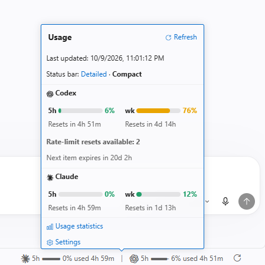
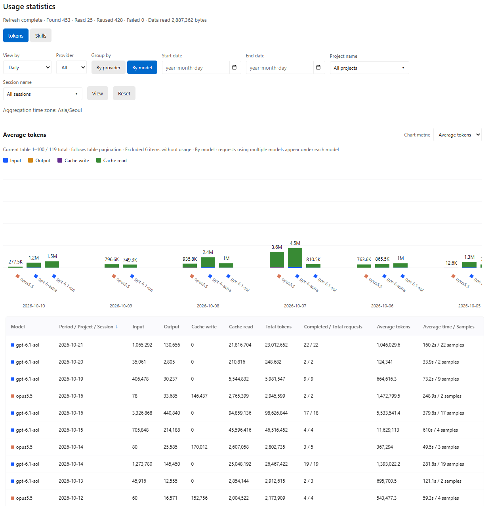

<p align="center">
  <a href="README.md">English</a> |
  <a href="README.ko.md">한국어</a> |
  <a href="README.zh.md">简体中文</a> |
  <a href="README.ja.md">日本語</a> |
  <strong><a href="README.es.md">Español</a></strong> |
  <a href="README.fr.md">Français</a>
</p>

# Agent Tracker

Una extensión de VS Code que muestra el uso actual de Claude y Codex y el tiempo hasta su restablecimiento, y registra el consumo de tokens y la duración de las tareas a partir de los registros de uso de agentes de IA.

## Funciones principales

### Consulta el uso desde la barra de estado

- **Uso actual** — Consulta el porcentaje de uso de las suscripciones de Claude y Codex y el tiempo hasta su restablecimiento en la barra de estado de VS Code.
- **Tarjeta de detalles** — Haz clic para ver el uso de 5 horas y semanal, los tiempos de restablecimiento y los restablecimientos de uso disponibles en Codex.
- **Actualización automática y manual** — El uso se consulta cada 15 minutos de forma predeterminada. Usa el botón de actualización para consultarlo de inmediato.

<p align="center">
  
</p>

### Compara tokens y tiempo por conversación, período y modelo

- **Estadísticas de tokens y tiempo** — Consulta el total de tokens, el promedio de tokens por solicitud y la duración media en tablas y gráficos por conversación, día, mes, proyecto o modelo.
- **Historial de uso** — Consulta el número de usos y las proporciones de habilidades, plugins, subagentes y modelos.
- **Mejora tu forma de trabajar** — Compara el promedio de tokens y tiempo por solicitud antes y después de cambiar de modelo o incorporar habilidades y plugins para ajustar cómo utilizas los agentes.

<p align="center">
  
</p>

Abre **Estadísticas de uso** desde la tarjeta o ejecuta **Agent Tracker: Abrir estadísticas de uso** en la paleta de comandos. Las estadísticas se calculan a partir de los registros locales de conversación al abrir la vista.

## Instalación y desinstalación

### Instalar y actualizar

- **Requisitos:** Node.js **22.15 o posterior**, VS Code **1.101 o posterior** y el comando `code` disponible en la terminal
- **Inicio de sesión:** Inicia sesión en la CLI de cada proveedor que uses: Claude Code o la CLI de Codex

Usa el mismo comando para instalar o actualizar:

```sh
npx agent-tracker-vscode@latest
```

Al finalizar, ejecuta **Developer: Reload Window** desde la paleta de comandos de VS Code.

<details>
<summary>Más opciones: instalación global · perfiles · configuración de macOS</summary>

**Instalación y actualización global**

```sh
npm install -g agent-tracker-vscode@latest
agent-tracker-vscode
```

**Instalar en un perfil:** Indica el nombre de un perfil que hayas creado previamente en VS Code.

```sh
npx agent-tracker-vscode@latest --profile "Work"
```

**macOS:** Si `code` no está disponible, ejecuta primero **Shell Command: Install 'code' command in PATH** desde la paleta de comandos de VS Code.

</details>

### Desinstalar

Selecciona **Agent Tracker → Desinstalar** en la vista de extensiones de VS Code o ejecuta:

```sh
code --uninstall-extension AgentTracker.agent-tracker
```

Si instalaste en un perfil específico, añade `--profile "Work"` al comando de desinstalación. Para eliminar también el paquete de npm instalado globalmente:

```sh
npm uninstall -g agent-tracker-vscode
```

El paquete de npm y la extensión de VS Code se desinstalan por separado.

## Ajustes de la extensión en VS Code

Haz clic en **Ajustes** en la tarjeta o busca `@ext:AgentTracker.agent-tracker` en los ajustes de VS Code.
Todas las claves siguientes llevan el prefijo `agentTracker.`.

| Ajuste | Valor predeterminado | Descripción |
| --- | --- | --- |
| `language` | `auto` | Sigue el idioma de VS Code. Permite elegir coreano, inglés, chino simplificado, japonés, español o francés |
| `claude.enabled` / `codex.enabled` | `true` | Activa las consultas de uso y las estadísticas de registros por proveedor |
| `quota.refreshPolicy` | `automatic` | Actualiza automáticamente. `manual` consulta solo al pulsar el botón de actualización |
| `quota.pollingIntervalSeconds` | `900` | Intervalo de actualización automática en segundos. Mínimo: 30; se pausa en ventanas inactivas |
| `display.percentage` | `used` | Las barras y los números muestran el uso. Las barras se llenan desde la izquierda. Con `remaining`, se vacían desde la derecha |
| `display.detail` | `detailed` | Muestra el uso de 7 días y 5 horas. `compact` muestra solo el de 5 horas |
| `display.colorMode` | `automatic` | Usa el color del tema. También admite `white`, `black` y `custom` |
| `display.customColor` | `#ffffff` | Color HEX para el modo `custom` |
| `codex.showReserve` | `false` | Muestra el uso de GPT Reserve si está disponible en la cuenta |
| `codex.showResetCredits` | `true` | Muestra los restablecimientos de uso disponibles y su próximo vencimiento si la cuenta los proporciona |
| `usage.enabled` | `true` | Activa las estadísticas de tokens y tiempo de los registros locales de conversación |
| `usage.skillsEnabled` | `true` | Cuenta los usos de habilidades, plugins, subagentes y modelos |
| `usage.showApiCosts` | `false` | Muestra costos estimados de API en USD. El uso de suscripción se muestra como 0 |
| `usage.excludeEmptyUsage` | `true` | Excluye de gráficos y promedios las solicitudes sin información de modelo ni tokens; las conserva en las tablas |
| `usage.timezone` | Zona horaria del sistema | Zona horaria de las estadísticas diarias y mensuales. Ejemplo: `Asia/Seoul` |
| `dataHome` | `~` | Carpeta principal común que contiene `.claude` y `.codex`. Se define en los ajustes de usuario |
| `claude.cleanupPeriodDays` | `null` | Días de conservación de registros de Claude. Un valor de 1 o más actualiza los ajustes de Claude; `null` conserva el valor existente |
| `codex.executable` | `codex` | Comando de la CLI de Codex o ruta al ejecutable |

Usa **Agent Tracker: Eliminar datos estadísticos** para borrar los resultados agregados. Se conservan los registros originales de conversación y las estadísticas se recalculan al volver a abrir la vista.

## Notas de la versión

<details open>
<summary>v0.3.1</summary>

- **Selección rápida de períodos** — Permite elegir los últimos 7, 30 o 90 días, todo el historial o fechas personalizadas. El valor predeterminado incluye hoy y los 6 días anteriores. Las fechas personalizadas muestran los campos de inicio y fin y sus calendarios.
- **Actualización de estadísticas más eficiente** — Lee y agrega los registros JSONL en una sola pasada y procesa varios archivos en paralelo cuando hay muchos datos. Para respuestas duplicadas, selecciona el registro preferido y ajusta los totales solo por la diferencia de sus contribuciones.
- **Escrituras y consultas de base de datos** — Actualiza solo las solicitudes modificadas y agrupa las escrituras y agregaciones diarias de varias sesiones. Reduce las consultas duplicadas y comparte los mismos resultados entre tablas, gráficos y recuentos totales de filas. Calcula los promedios de entrada, salida y caché cuando los necesita el gráfico de tokens promedio, reduciendo el trabajo de agregación para otros gráficos.
- **Uso de subagentes de Codex** — Suma el uso de los subagentes, incluidos los anidados, a la solicitud principal. Vincula los que no tienen identificador de solicitud mediante su historial de creación y mejora la gestión de cadenas largas, ciclos y agentes principales ausentes.
- **Actualización de registros movidos** — Verifica la identidad y el contenido antes de vincular la nueva ruta y eliminar el registro de la anterior, de modo que el uso añadido después de mover un archivo siga actualizando las estadísticas. La comprobación del contenido también protege el uso guardado cuando el sistema operativo reutiliza el identificador de un archivo eliminado para otro archivo.
- **Controles por proveedor** — Las opciones de activación de Claude y Codex controlan el seguimiento del uso y su visibilidad en la barra de estado, la tarjeta de uso y las estadísticas.
- **Indicadores de uso y capacidad restante** — Las barras y los porcentajes siguen el modo de visualización seleccionado. Las barras de uso se llenan desde la izquierda y las de capacidad restante disminuyen desde el extremo derecho.
- **Tarjeta de uso y accesibilidad** — Restaura la tarjeta completa al pasar el cursor y, con el parche local de workbench, permite fijarla o cerrarla con un clic. Los resúmenes accesibles anuncian primero Codex, con el uso restante semanal y de 5 horas y los tiempos de reinicio, incluso en modo compacto.
- **Compatibilidad de las consultas de uso** — Elimina el límite arbitrario de 100 ventanas de uso en las respuestas de Claude y Codex y utiliza la versión instalada de la extensión en los metadatos de comunicación.
- **Idioma predeterminado para idiomas no compatibles** — Muestra inglés cuando el idioma de VS Code no es compatible.
- **Nuevo icono de la extensión** — Sustituye el icono y reduce el tamaño del archivo de imagen.

[Cambios de algoritmos, mejoras medidas frente a v0.2.0 y limitaciones (en coreano)](docs/Performance-v0.3.0.ko.md)

</details>

<details>
<summary>v0.2.0</summary>

- **Rendimiento de la base de datos** — Los índices optimizan las consultas por período y proyecto, y las agregaciones diarias (rollup) mejoran las estadísticas por modelo y el cálculo de promedios.
- **Registros comprimidos de Codex** — Las estadísticas incluyen las conversaciones antiguas que Codex ha comprimido con Zstd (`.jsonl.zst`).
- **Conservación de estadísticas** — Las estadísticas válidas guardadas en la base de datos se conservan de forma predeterminada aunque se eliminen las conversaciones originales, incluso durante la limpieza automática de Claude.
- **Gráficos más claros** — Las vistas por proveedor también muestran sus colores, y los encabezados de las tablas permiten ordenar de forma ascendente o descendente.
- **Filas por página ajustables** — Elige cuántas filas mostrar por página en la vista de estadísticas.

</details>

<br><br>

[Referencia de uso y desarrollo (en coreano)](docs/refrences/Development.ko.md)
