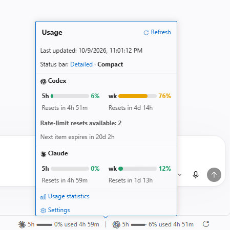
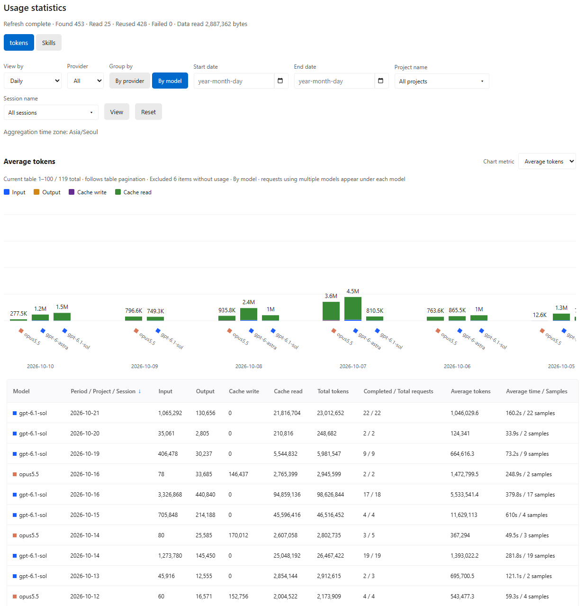

<p align="center">
  <a href="README.md">English</a> |
  <a href="README.ko.md">한국어</a> |
  <a href="README.zh.md">简体中文</a> |
  <a href="README.ja.md">日本語</a> |
  <a href="README.es.md">Español</a> |
  <strong><a href="README.fr.md">Français</a></strong>
</p>

# Agent Tracker

Une extension VS Code qui affiche l'utilisation actuelle de Claude et Codex et le temps avant réinitialisation, et suit la consommation de tokens et la durée des tâches à partir de l'historique d'utilisation des agents d'IA.

## Fonctionnalités principales

### Consultez l'utilisation dans la barre d'état

- **Utilisation actuelle** — Consultez le taux d'utilisation des abonnements Claude et Codex et le temps avant réinitialisation dans la barre d'état de VS Code.
- **Carte détaillée** — Cliquez pour afficher l'utilisation sur 5 heures et sur une semaine, les échéances de réinitialisation et les réinitialisations d'utilisation disponibles pour Codex.
- **Actualisation automatique et manuelle** — L'utilisation est consultée toutes les 15 minutes par défaut. Le bouton d'actualisation permet de la consulter immédiatement.

<p align="center">
  
</p>

### Comparez les tokens et le temps par conversation, période et modèle

- **Statistiques de tokens et de temps** — Consultez le total de tokens, la moyenne de tokens par requête et la durée moyenne dans des tableaux et graphiques par conversation, jour, mois, projet ou modèle.
- **Historique d'utilisation** — Consultez le nombre d'utilisations et les proportions des skills, plugins, sous-agents et modèles.
- **Améliorez vos méthodes de travail** — Comparez la moyenne de tokens et de temps par requête avant et après un changement de modèle ou l'ajout de skills et de plugins pour ajuster votre utilisation des agents.

<p align="center">
  
</p>

Ouvrez **Statistiques d'utilisation** depuis la carte ou lancez **Agent Tracker : Ouvrir les statistiques d'utilisation** depuis la palette de commandes. Les statistiques sont calculées à partir des journaux locaux de conversation à l'ouverture de la vue.

## Installation et désinstallation

### Installer et mettre à jour

- **Prérequis :** Node.js **22.15 ou ultérieur**, VS Code **1.101 ou ultérieur** et la commande `code` disponible dans le terminal
- **Connexion :** Connectez-vous à la CLI de chaque fournisseur utilisé : Claude Code ou la CLI Codex

Utilisez la même commande pour installer ou mettre à jour :

```sh
npx agent-tracker-vscode@latest
```

Une fois terminé, lancez **Developer: Reload Window** depuis la palette de commandes de VS Code.
Si Agent Tracker vous invite à mettre à jour le comportement au clic de la carte d’utilisation, quittez complètement VS Code, patientez un instant, puis rouvrez-le. Le correctif s’applique à la fermeture sur les installations locales compatibles de Windows et Linux.

<details>
<summary>Autres options : installation globale · profils · configuration macOS</summary>

**Installation et mise à jour globales**

```sh
npm install -g agent-tracker-vscode@latest
agent-tracker-vscode
```

**Installer dans un profil :** Indiquez le nom d'un profil déjà créé dans VS Code.

```sh
npx agent-tracker-vscode@latest --profile "Work"
```

**macOS :** Si `code` n'est pas disponible, lancez d'abord **Shell Command: Install 'code' command in PATH** depuis la palette de commandes de VS Code.

</details>

### Désinstaller

Sélectionnez **Agent Tracker → Désinstaller** dans la vue Extensions de VS Code, ou exécutez :

```sh
code --uninstall-extension AgentTracker.agent-tracker
```

Si vous avez installé l'extension dans un profil précis, ajoutez `--profile "Work"` à la commande de désinstallation. Pour supprimer également le paquet npm installé globalement :

```sh
npm uninstall -g agent-tracker-vscode
```

Le paquet npm et l'extension VS Code se désinstallent séparément.

## Paramètres de l'extension VS Code

Cliquez sur **Paramètres** dans la carte ou recherchez `@ext:AgentTracker.agent-tracker` dans les paramètres de VS Code.
Toutes les clés ci-dessous portent le préfixe `agentTracker.`.

| Paramètre | Valeur par défaut | Description |
| --- | --- | --- |
| `language` | `auto` | Suit la langue de VS Code. Choix : coréen, anglais, chinois simplifié, japonais, espagnol ou français |
| `claude.enabled` / `codex.enabled` | `true` | Active les requêtes d'utilisation et les statistiques des journaux par fournisseur |
| `quota.refreshPolicy` | `automatic` | Actualise automatiquement. `manual` consulte l'utilisation uniquement au clic sur Actualiser |
| `quota.pollingIntervalSeconds` | `900` | Intervalle d'actualisation automatique en secondes. Minimum : 30 ; pause dans les fenêtres inactives |
| `display.percentage` | `used` | Les jauges et les nombres affichent l’utilisation. Les jauges se remplissent depuis la gauche. Avec `remaining`, elles se vident depuis la droite |
| `display.detail` | `detailed` | Affiche l'utilisation sur 7 jours et 5 heures. `compact` affiche uniquement celle sur 5 heures |
| `display.colorMode` | `automatic` | Utilise la couleur du thème. Accepte aussi `white`, `black` et `custom` |
| `display.customColor` | `#ffffff` | Couleur HEX du mode `custom` |
| `codex.showReserve` | `false` | Affiche l'utilisation de GPT Reserve si le compte la fournit |
| `codex.showResetCredits` | `true` | Affiche les réinitialisations d'utilisation disponibles et leur prochaine expiration si le compte les fournit |
| `usage.enabled` | `true` | Active les statistiques de tokens et de temps issues des journaux locaux de conversation |
| `usage.skillsEnabled` | `true` | Compte les utilisations des skills, plugins, sous-agents et modèles |
| `usage.showApiCosts` | `false` | Affiche les coûts API estimés en USD. L'utilisation par abonnement est affichée à 0 |
| `usage.excludeEmptyUsage` | `true` | Exclut des graphiques et des moyennes les requêtes sans information de modèle ni de tokens ; les conserve dans les tableaux |
| `usage.timezone` | Fuseau horaire du système | Fuseau des statistiques quotidiennes et mensuelles. Exemple : `Asia/Seoul` |
| `dataHome` | `~` | Dossier parent commun contenant `.claude` et `.codex`. À définir dans les paramètres utilisateur |
| `claude.cleanupPeriodDays` | `null` | Durée de conservation des journaux Claude, en jours. Une valeur d'au moins 1 met à jour les paramètres Claude ; `null` conserve la valeur existante |
| `codex.executable` | `codex` | Commande de la CLI Codex ou chemin de l'exécutable |

Utilisez **Agent Tracker : Supprimer les données statistiques** pour effacer les résultats agrégés. Les journaux de conversation d'origine sont conservés et les statistiques sont recalculées à la prochaine ouverture de la vue.

## Notes de version

<details open>
<summary>v0.4.0</summary>

- **Affichage initial des statistiques** — Les 30 derniers jours s’appliquent par défaut et après une réinitialisation des filtres. Le premier tableau est chargé depuis SQLite après l’actualisation. En cas d’échec ou d’annulation, vous pouvez relancer l’actualisation.
- **Statistiques des conversations terminées** — Les totaux quotidiens et mensuels sont regroupés selon la date de début de la conversation. Le nombre de conversations et la moyenne de tokens se fondent sur les conversations terminées, et la durée moyenne inclut uniquement celles dont la durée est connue.
- **Actualisation incrémentale des journaux** — La date de modification permet de repérer les journaux nouveaux ou modifiés. Les journaux associés sont lus si nécessaire pour recalculer les sessions concernées. Un journal déplacé est lu à son nouvel emplacement et le réglage de conservation des fichiers supprimés s’applique à l’ancien chemin.
- **Analyse JSONL et agrégation des tokens** — Seuls les champs nécessaires sont lus, les tampons des lignes longues sont réutilisés et les réponses en double sont fusionnées pendant la collecte. Pour Codex, l’historique recopié est écarté et l’utilisation vérifiée à partir des compteurs cumulés du tour ou du fil est ajoutée.
- **Stockage quotidien dans SQLite** — Les données existantes sont migrées vers des totaux quotidiens par fournisseur, modèle et outil. L’écriture se limite aux lignes modifiées. L’onglet Skill charge ses quatre catégories en une seule requête, et les requêtes sur les coûts et le nombre de lignes répètent moins de calculs.
- **Clics sur la carte d’utilisation** — Le comportement d’ouverture, d’épinglage et de fermeture par clic a été corrigé. Sur les installations locales compatibles de Windows et Linux, la mise à jour s’applique automatiquement après la fermeture complète de VS Code.

Avec une base vide et 10 000 conversations synthétiques, le délai entre le début de la collecte et l’affichage du premier tableau de statistiques est passé de **879.6 à 701.6 ms (-20.2%)**. [Comparaison des performances de la vue des statistiques et de SQLite avec v0.3.1 (en coréen)](docs/benchmarks/success/2026-11-28/MainDevDashboardAB-2026-11-28.md)

</details>

<details>
<summary>v0.3.1</summary>

- **Sélection rapide des périodes** — Choisissez les 7, 30 ou 90 derniers jours, tout l'historique ou des dates personnalisées. La période par défaut comprend aujourd'hui et les 6 jours précédents. Les dates personnalisées affichent les champs de début et de fin et leurs calendriers.
- **Commandes par fournisseur** — Les paramètres d'activation de Claude et Codex contrôlent le suivi de leur utilisation et leur affichage dans la barre d'état, la carte d'utilisation et les statistiques.
- **Jauges d'utilisation et de quota restant** — Les barres et les pourcentages suivent le mode d'affichage sélectionné. Les barres d'utilisation se remplissent depuis la gauche et celles du quota restant diminuent depuis l'extrémité droite.
- **Vérification des journaux déplacés** — Le journal est associé au nouveau chemin uniquement si son contenu correspond. Les statistiques stockées sont ainsi protégées si le système réutilise l’identifiant d’un fichier supprimé.
- **Calcul du graphique des tokens moyens** — Les moyennes d’entrée, de sortie et de cache sont calculées uniquement pour le graphique des tokens moyens.
- **README du paquet npm** — Le paquet d’installation inclut le README principal avec des captures d’écran et des liens vers la documentation accessibles depuis npm.

</details>

<details>
<summary>v0.3.0</summary>

- **Actualisation des statistiques plus efficace** — Lit et agrège les journaux JSONL en un seul passage et traite plusieurs fichiers en parallèle pour les ensembles volumineux. Pour les réponses en double, sélectionne l'enregistrement privilégié et ajuste les totaux uniquement de la différence entre leurs contributions.
- **Écritures et requêtes de base de données** — Met à jour uniquement les requêtes modifiées et regroupe les écritures et agrégations quotidiennes de plusieurs sessions. Réduit les requêtes en double et partage les mêmes résultats entre tableaux, graphiques et nombre total de lignes.
- **Utilisation des sous-agents Codex** — Additionne l'utilisation des sous-agents, y compris imbriqués, à la requête parente. Relie ceux sans identifiant de requête grâce à leur historique de création et améliore la gestion des longues chaînes, des cycles et des parents manquants.
- **Actualisation des journaux déplacés** — Vérifie l'identité et le contenu avant de relier le nouveau chemin et de supprimer l'ancien enregistrement, afin que l'utilisation ajoutée après un déplacement continue d'actualiser les statistiques.
- **Carte d'utilisation et accessibilité** — Rétablit la carte complète au survol et, avec le correctif local de workbench, permet de l'épingler ou de la fermer par un clic. Les résumés accessibles annoncent Codex en premier, avec les quotas restants hebdomadaires et sur 5 heures et les délais de réinitialisation, même en mode compact.
- **Compatibilité des requêtes d'utilisation** — Supprime la limite arbitraire de 100 fenêtres d'utilisation dans les réponses Claude et Codex et utilise la version installée de l'extension dans les métadonnées de communication.
- **Langue par défaut pour les langues non prises en charge** — Affiche l'anglais lorsque la langue de VS Code n'est pas prise en charge.
- **Nouvelle icône de l'extension** — Remplace l'icône et réduit la taille du fichier image.

[Évolution des algorithmes, gains mesurés depuis v0.2.0 et limites (en coréen)](docs/Performance-v0.3.0.ko.md)

</details>

<details>
<summary>v0.2.0</summary>

- **Performances de la base de données** — Les index optimisent les recherches par période et projet, et les agrégations quotidiennes (rollup) améliorent les statistiques par modèle et le calcul des moyennes.
- **Journaux Codex compressés** — Les statistiques incluent les anciennes conversations compressées par Codex avec Zstd (`.jsonl.zst`).
- **Conservation des statistiques** — Les statistiques valides enregistrées dans la base sont conservées par défaut après la suppression des conversations source, y compris lors du nettoyage automatique de Claude.
- **Graphiques plus lisibles** — Les vues par fournisseur affichent aussi leurs couleurs, et les en-têtes des tableaux permettent de trier par ordre croissant ou décroissant.
- **Nombre de lignes par page réglable** — Choisissez le nombre de lignes à afficher par page dans la vue des statistiques.

</details>

## Collecte des statistiques d'utilisation

Un projet est un dossier de travail. Une session regroupe les conversations d’un même chat. Une conversation va du message de l’utilisateur à la réponse de l’agent principal et inclut l’usage des sous-agents associés. Agent Tracker lit les journaux JSONL et les journaux Codex compressés avec Zstd.

### Champs lus dans les journaux

| Rôle | Claude | Codex |
| --- | --- | --- |
| Session et fil de conversation | Utilise `sessionId` dans le journal principal ou le nom du fichier si ce champ est absent. Les journaux des sous-agents sont identifiés par le dossier de leur session et leur nom de fichier. | Identifie le fil avec `payload.id` dans `session_meta` ou `payload.thread_id` dans `token_usage_record`. Si `payload.session_id` est absent, utilise l'identifiant du fil comme identifiant de session. |
| Modèle et réponse | Lit `message.model`, `message.id` et `requestId` dans les lignes `assistant`. Le champ `isApiErrorMessage` sert à écarter les réponses d'erreur avec zéro token. | Lit `payload.model` dans les lignes d'utilisation ou dans le contexte de la session ou du tour. Les champs `payload.turn_id` et `payload.response_id` identifient la réponse. |
| Tokens d'entrée, de sortie et de cache | Lit `input_tokens`, `output_tokens`, `cache_read_input_tokens` et `cache_creation_input_tokens` dans `message.usage`. | Lit `input_tokens` et `output_tokens` dans `payload.usage`. Les compteurs de cache proviennent de `cached_input_tokens` et `cache_write_input_tokens` ou de `input_tokens_details.cached_tokens` et `input_tokens_details.cache_write_tokens`. |
| Compteurs cumulés et références au fil parent | — | Lit `payload.thread_token_usage`, `payload.turn_token_usage` et, dans les événements `token_count` de l'ancien format, `payload.info.total_token_usage` et `payload.info.last_token_usage`. Dans `session_meta`, relève `forked_from_id` ou une référence `parent_thread_id` directe ou imbriquée. |
| Horodatage | Lit `timestamp` dans la ligne. | Lit `timestamp` dans la ligne ou `payload.timestamp`, ainsi que `payload.started_at` et `payload.completed_at` dans les événements. |

### Des journaux aux totaux quotidiens

1. Parcourt le JSONL ligne par ligne et extrait les champs dont les chemins sont prédéfinis. Si une ligne s'étend sur plusieurs blocs de lecture, conserve l'état de l'analyse syntaxique du JSON et les valeurs déjà extraites. Ignore les données d'image en Base64 pendant la lecture.
2. Claude repère les doublons par `(message.id, requestId)` au sein d'une session, et Codex par `(turn_id, response_id)` au sein d'un fil. Lorsqu'un seul identifiant de requête est connu pour un message Claude, les lignes sans cet identifiant entrent aussi dans la comparaison. Pour chaque réponse en double, seule la ligne ayant la plus grande somme de tokens d'entrée et de sortie est comptée. Claude ajoute à l'entrée les tokens lus et écrits dans le cache. Codex utilise le total d'entrée consigné dans le journal.
3. Compare les enregistrements Codex de l'ancien format avec le fil parent pour écarter l'historique copié, puis additionne les augmentations vérifiées des compteurs restants. Si le cumul du fil présente une hausse inexpliquée par les réponses, celle-ci est vérifiée à l'aide des cumuls par tour ou des anciens enregistrements avant d'être ajoutée.
4. Regroupe l’usage par date de début de la conversation dans le fuseau horaire des statistiques. Compte les conversations terminées et calcule la durée moyenne pour celles dont la durée est connue.

### Tables SQLite

| Table | Données stockées |
| --- | --- |
| `source_file` | Chemins des journaux, identifiants de session et de fil, horodatages de modification, versions de l'analyseur, état du traitement et présence ou absence du fichier source. |
| `usage_request_daily` | Totaux de tokens, de durée et de coût, et nombres d'échantillons par fournisseur, session, projet et date locale. |
| `usage_model_daily` | Totaux quotidiens et nombres d'échantillons avec une clé de modèle supplémentaire. |
| `projects`, `sessions` | Noms d'affichage des projets et des sessions. |
| `session_billing` | Mode de facturation choisi par l'utilisateur pour chaque fournisseur et session. |
| `usage_rollup_meta` | Fuseau horaire et version du format utilisés pour l'agrégation quotidienne. |
| `usage_capability_daily` | Nombre quotidien d’utilisations des compétences, des sous-agents, des extensions et des modèles. |

La vue des statistiques filtre les lignes quotidiennes par fournisseur ou modèle selon la période sélectionnée, puis les regroupe selon le critère choisi. Les moyennes sont calculées à partir des totaux et des nombres d'échantillons enregistrés.
