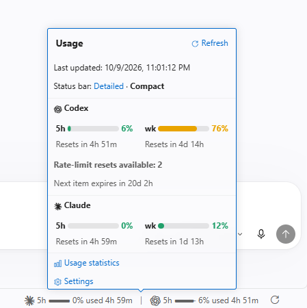
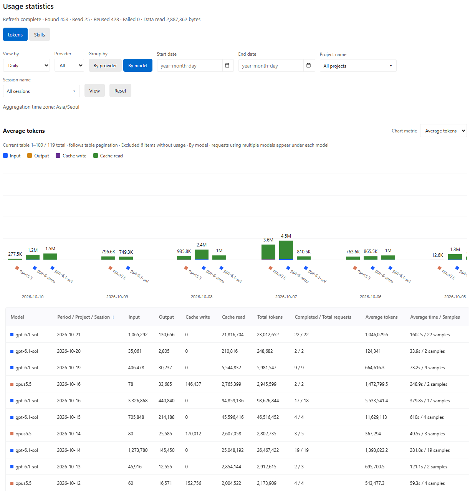

<p align="center">
  <a href="README.md">English</a> |
  <a href="README.ko.md">한국어</a> |
  <a href="README.zh.md">简体中文</a> |
  <a href="README.ja.md">日本語</a> |
  <a href="README.es.md">Español</a> |
  <strong><a href="README.fr.md">Français</a></strong>
</p>

# Agent Tracker

Une extension VS Code qui affiche l'utilisation actuelle de Claude et Codex et le temps avant réinitialisation, et suit la consommation de tokens et la durée des tâches à partir de l'historique d'utilisation des agents d'IA.

## Fonctionnalités principales

### Consultez l'utilisation dans la barre d'état

- **Utilisation actuelle** — Consultez le taux d'utilisation des abonnements Claude et Codex et le temps avant réinitialisation dans la barre d'état de VS Code.
- **Carte détaillée** — Cliquez pour afficher l'utilisation sur 5 heures et sur une semaine, les échéances de réinitialisation et les réinitialisations d'utilisation disponibles pour Codex.
- **Actualisation automatique et manuelle** — L'utilisation est consultée toutes les 15 minutes par défaut. Le bouton d'actualisation permet de la consulter immédiatement.

<p align="center">
  
</p>

### Comparez les tokens et le temps par conversation, période et modèle

- **Statistiques de tokens et de temps** — Consultez le total de tokens, la moyenne de tokens par requête et la durée moyenne dans des tableaux et graphiques par conversation, jour, mois, projet ou modèle.
- **Historique d'utilisation** — Consultez le nombre d'utilisations et les proportions des skills, plugins, sous-agents et modèles.
- **Améliorez vos méthodes de travail** — Comparez la moyenne de tokens et de temps par requête avant et après un changement de modèle ou l'ajout de skills et de plugins pour ajuster votre utilisation des agents.

<p align="center">
  
</p>

Ouvrez **Statistiques d'utilisation** depuis la carte ou lancez **Agent Tracker : Ouvrir les statistiques d'utilisation** depuis la palette de commandes. Les statistiques sont calculées à partir des journaux locaux de conversation à l'ouverture de la vue.

## Installation et désinstallation

### Installer et mettre à jour

- **Prérequis :** Node.js **22.15 ou ultérieur**, VS Code **1.101 ou ultérieur** et la commande `code` disponible dans le terminal
- **Connexion :** Connectez-vous à la CLI de chaque fournisseur utilisé : Claude Code ou la CLI Codex

Utilisez la même commande pour installer ou mettre à jour :

```sh
npx agent-tracker-vscode@latest
```

Une fois terminé, lancez **Developer: Reload Window** depuis la palette de commandes de VS Code.

<details>
<summary>Autres options : installation globale · profils · configuration macOS</summary>

**Installation et mise à jour globales**

```sh
npm install -g agent-tracker-vscode@latest
agent-tracker-vscode
```

**Installer dans un profil :** Indiquez le nom d'un profil déjà créé dans VS Code.

```sh
npx agent-tracker-vscode@latest --profile "Work"
```

**macOS :** Si `code` n'est pas disponible, lancez d'abord **Shell Command: Install 'code' command in PATH** depuis la palette de commandes de VS Code.

</details>

### Désinstaller

Sélectionnez **Agent Tracker → Désinstaller** dans la vue Extensions de VS Code, ou exécutez :

```sh
code --uninstall-extension AgentTracker.agent-tracker
```

Si vous avez installé l'extension dans un profil précis, ajoutez `--profile "Work"` à la commande de désinstallation. Pour supprimer également le paquet npm installé globalement :

```sh
npm uninstall -g agent-tracker-vscode
```

Le paquet npm et l'extension VS Code se désinstallent séparément.

## Paramètres de l'extension VS Code

Cliquez sur **Paramètres** dans la carte ou recherchez `@ext:AgentTracker.agent-tracker` dans les paramètres de VS Code.
Toutes les clés ci-dessous portent le préfixe `agentTracker.`.

| Paramètre | Valeur par défaut | Description |
| --- | --- | --- |
| `language` | `auto` | Suit la langue de VS Code. Choix : coréen, anglais, chinois simplifié, japonais, espagnol ou français |
| `claude.enabled` / `codex.enabled` | `true` | Active les requêtes d'utilisation et les statistiques des journaux par fournisseur |
| `quota.refreshPolicy` | `automatic` | Actualise automatiquement. `manual` consulte l'utilisation uniquement au clic sur Actualiser |
| `quota.pollingIntervalSeconds` | `900` | Intervalle d'actualisation automatique en secondes. Minimum : 30 ; pause dans les fenêtres inactives |
| `display.percentage` | `used` | Les jauges et les nombres affichent l’utilisation. Les jauges se remplissent depuis la gauche. Avec `remaining`, elles se vident depuis la droite |
| `display.detail` | `detailed` | Affiche l'utilisation sur 7 jours et 5 heures. `compact` affiche uniquement celle sur 5 heures |
| `display.colorMode` | `automatic` | Utilise la couleur du thème. Accepte aussi `white`, `black` et `custom` |
| `display.customColor` | `#ffffff` | Couleur HEX du mode `custom` |
| `codex.showReserve` | `false` | Affiche l'utilisation de GPT Reserve si le compte la fournit |
| `codex.showResetCredits` | `true` | Affiche les réinitialisations d'utilisation disponibles et leur prochaine expiration si le compte les fournit |
| `usage.enabled` | `true` | Active les statistiques de tokens et de temps issues des journaux locaux de conversation |
| `usage.skillsEnabled` | `true` | Compte les utilisations des skills, plugins, sous-agents et modèles |
| `usage.showApiCosts` | `false` | Affiche les coûts API estimés en USD. L'utilisation par abonnement est affichée à 0 |
| `usage.excludeEmptyUsage` | `true` | Exclut des graphiques et des moyennes les requêtes sans information de modèle ni de tokens ; les conserve dans les tableaux |
| `usage.timezone` | Fuseau horaire du système | Fuseau des statistiques quotidiennes et mensuelles. Exemple : `Asia/Seoul` |
| `dataHome` | `~` | Dossier parent commun contenant `.claude` et `.codex`. À définir dans les paramètres utilisateur |
| `claude.cleanupPeriodDays` | `null` | Durée de conservation des journaux Claude, en jours. Une valeur d'au moins 1 met à jour les paramètres Claude ; `null` conserve la valeur existante |
| `codex.executable` | `codex` | Commande de la CLI Codex ou chemin de l'exécutable |

Utilisez **Agent Tracker : Supprimer les données statistiques** pour effacer les résultats agrégés. Les journaux de conversation d'origine sont conservés et les statistiques sont recalculées à la prochaine ouverture de la vue.

## Notes de version

<details open>
<summary>v0.2.1</summary>

- **Sélection rapide des périodes** — Choisissez les 7, 30 ou 90 derniers jours, tout l'historique ou des dates personnalisées. La période par défaut comprend aujourd'hui et les 6 jours précédents. Les dates personnalisées affichent les champs de début et de fin et leurs calendriers.
- **Actualisation des statistiques plus efficace** — Lit et agrège les journaux JSONL en un seul passage et traite plusieurs fichiers en parallèle pour les ensembles volumineux. Pour les réponses en double, sélectionne l'enregistrement privilégié et ajuste les totaux uniquement de la différence entre leurs contributions.
- **Écritures et requêtes de base de données** — Met à jour uniquement les requêtes modifiées et regroupe les écritures et agrégations quotidiennes de plusieurs sessions. Réduit les requêtes en double et partage les mêmes résultats entre tableaux, graphiques et nombre total de lignes. Calcule les moyennes d'entrée, de sortie et de cache lorsque le graphique des tokens moyens en a besoin, réduisant le travail d'agrégation pour les autres graphiques.
- **Utilisation des sous-agents Codex** — Additionne l'utilisation des sous-agents, y compris imbriqués, à la requête parente. Relie ceux sans identifiant de requête grâce à leur historique de création et améliore la gestion des longues chaînes, des cycles et des parents manquants.
- **Actualisation des journaux déplacés** — Vérifie l'identité et le contenu avant de relier le nouveau chemin et de supprimer l'ancien enregistrement, afin que l'utilisation ajoutée après un déplacement continue d'actualiser les statistiques. La vérification du contenu protège aussi l'utilisation enregistrée lorsque le système d'exploitation réattribue l'identifiant d'un fichier supprimé à un autre fichier.
- **Commandes par fournisseur** — Les paramètres d'activation de Claude et Codex contrôlent le suivi de leur utilisation et leur affichage dans la barre d'état, la carte d'utilisation et les statistiques.
- **Jauges d'utilisation et de quota restant** — Les barres et les pourcentages suivent le mode d'affichage sélectionné. Les barres d'utilisation se remplissent depuis la gauche et celles du quota restant diminuent depuis l'extrémité droite.
- **Carte d'utilisation et accessibilité** — Rétablit la carte complète au survol et, avec le correctif local de workbench, permet de l'épingler ou de la fermer par un clic. Les résumés accessibles annoncent Codex en premier, avec les quotas restants hebdomadaires et sur 5 heures et les délais de réinitialisation, même en mode compact.
- **Compatibilité des requêtes d'utilisation** — Supprime la limite arbitraire de 100 fenêtres d'utilisation dans les réponses Claude et Codex et utilise la version installée de l'extension dans les métadonnées de communication.
- **Langue par défaut pour les langues non prises en charge** — Affiche l'anglais lorsque la langue de VS Code n'est pas prise en charge.
- **Nouvelle icône de l'extension** — Remplace l'icône et réduit la taille du fichier image.

[Évolution des algorithmes, gains mesurés depuis v0.2.0 et limites (en coréen)](docs/Performance-v0.3.0.ko.md)

</details>

<details>
<summary>v0.2.0</summary>

- **Performances de la base de données** — Les index optimisent les recherches par période et projet, et les agrégations quotidiennes (rollup) améliorent les statistiques par modèle et le calcul des moyennes.
- **Journaux Codex compressés** — Les statistiques incluent les anciennes conversations compressées par Codex avec Zstd (`.jsonl.zst`).
- **Conservation des statistiques** — Les statistiques valides enregistrées dans la base sont conservées par défaut après la suppression des conversations source, y compris lors du nettoyage automatique de Claude.
- **Graphiques plus lisibles** — Les vues par fournisseur affichent aussi leurs couleurs, et les en-têtes des tableaux permettent de trier par ordre croissant ou décroissant.
- **Nombre de lignes par page réglable** — Choisissez le nombre de lignes à afficher par page dans la vue des statistiques.

</details>

<br><br>

[Référence d'utilisation et de développement (en coréen)](docs/refrences/Development.ko.md)
