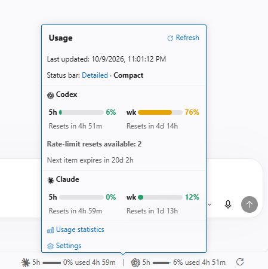
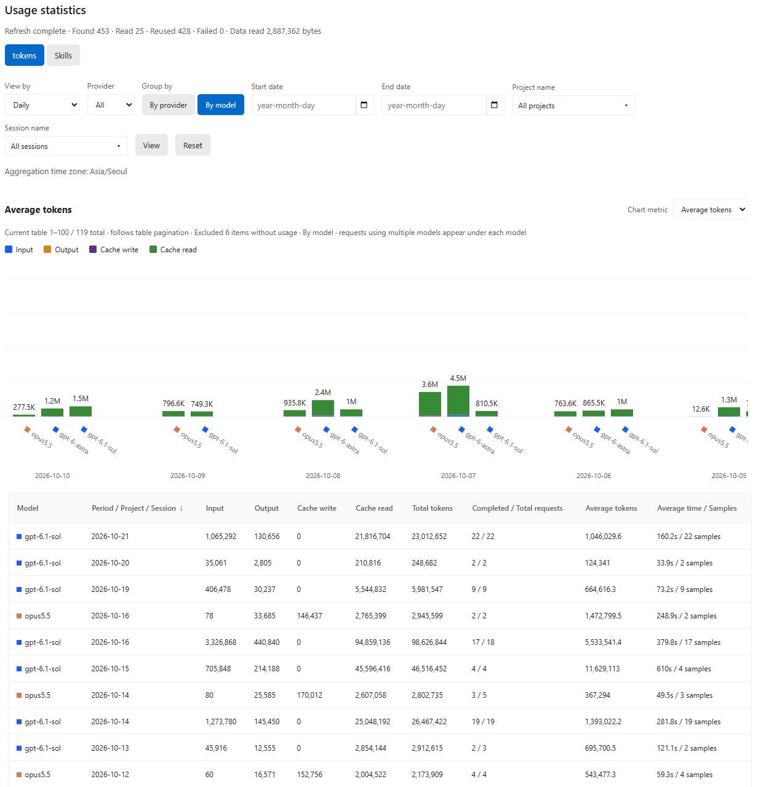

<p align="center">
  <a href="README.md">English</a> |
  <a href="README.ko.md">한국어</a> |
  <a href="README.zh.md">简体中文</a> |
  <strong><a href="README.ja.md">日本語</a></strong> |
  <a href="README.es.md">Español</a> |
  <a href="README.fr.md">Français</a>
</p>

# Agent Tracker

Claude・Codex の現在の使用量とリセットまでの時間を表示し、AIエージェントの利用記録をもとにトークン使用量と作業の所要時間を追跡する VS Code 拡張機能です。

## 主な機能

### ステータスバーで使用量を確認

- **現在の使用量** — VS Code のステータスバーで、Claude・Codex のサブスクリプション使用率とリセットまでの時間を確認できます。
- **詳細カード** — クリックすると、5時間・週間の使用量、リセット時刻、Codex の利用可能な使用量リセット回数などを表示します。
- **自動・手動更新** — 既定では15分ごとに取得します。更新ボタンで直ちに取得することもできます。

<p align="center">
  
</p>

### 会話・期間・モデル別にトークンと時間を比較

- **トークン・時間の統計** — 会話・日・月・プロジェクト・モデル別の合計トークン数、リクエスト当たりの平均トークン数、平均所要時間を表とグラフで確認できます。
- **利用記録** — スキル・プラグイン・サブエージェント・モデルの利用回数と割合を確認できます。
- **使い方の改善** — モデルの変更やスキル・プラグインの導入前後で、リクエスト当たりの平均トークン数と時間を比較し、エージェントの使い方を調整できます。

<p align="center">
  
</p>

カードの **使用統計**、またはコマンドパレットの **Agent Tracker：使用統計を開く** から開きます。統計は画面を開く際にローカルの会話ログから計算します。

## インストールとアンインストール

### インストールと更新

- **動作環境：** Node.js **22.15 以降**、VS Code **1.101 以降**、ターミナルで実行できる `code` コマンド
- **ログイン：** 利用するプロバイダーのCLI（Claude Code または Codex CLI）で事前にログイン

インストールと更新には同じコマンドを使います。

```sh
npx agent-tracker-vscode@latest
```

完了したら、VS Code のコマンドパレットで **Developer: Reload Window** を実行してください。

<details>
<summary>追加オプション：グローバルインストール・プロファイル指定・macOS設定</summary>

**グローバルインストールと更新**

```sh
npm install -g agent-tracker-vscode@latest
agent-tracker-vscode
```

**特定のプロファイルにインストール：** VS Code で作成済みのプロファイル名を指定します。

```sh
npx agent-tracker-vscode@latest --profile "Work"
```

**macOS：** `code` コマンドがない場合は、先に VS Code のコマンドパレットで **Shell Command: Install 'code' command in PATH** を実行してください。

</details>

### アンインストール

VS Code の拡張機能一覧から **Agent Tracker → アンインストール** を選ぶか、次を実行します。

```sh
code --uninstall-extension AgentTracker.agent-tracker
```

特定のプロファイルにインストールした場合は、削除コマンドにも `--profile "Work"` を付けます。グローバルにインストールした npm パッケージも削除する場合は、次を実行します。

```sh
npm uninstall -g agent-tracker-vscode
```

npm パッケージと VS Code 拡張機能はそれぞれアンインストールします。

## VS Code 拡張機能の設定

カードの **設定** をクリックするか、VS Code の設定で `@ext:AgentTracker.agent-tracker` を検索します。
以下の設定キーにはすべて `agentTracker.` 接頭辞が付きます。

| 設定 | 既定値 | 説明 |
| --- | --- | --- |
| `language` | `auto` | VS Code の言語に従う。韓国語・英語・簡体字中国語・日本語・スペイン語・フランス語を選択可能 |
| `claude.enabled` / `codex.enabled` | `true` | プロバイダー別の使用量取得・ログ統計の追跡 |
| `quota.refreshPolicy` | `automatic` | 自動で取得。`manual` は更新ボタンを押したときのみ取得 |
| `quota.pollingIntervalSeconds` | `900` | 自動取得の間隔（秒）。最小30秒、非アクティブなウィンドウでは一時停止 |
| `display.percentage` | `used` | 使用率を表示。`remaining` は残りの割合を表示 |
| `display.detail` | `detailed` | 7日・5時間の使用量を表示。`compact` は5時間のみ表示 |
| `display.colorMode` | `automatic` | テーマの色を使用。`white`・`black`・`custom` も選択可能 |
| `display.customColor` | `#ffffff` | `custom` モードで使用する HEX カラー |
| `codex.showReserve` | `false` | アカウントで提供される GPT Reserve の使用量を表示 |
| `codex.showResetCredits` | `true` | アカウントで提供される使用量リセット回数と次の有効期限を表示 |
| `usage.enabled` | `true` | ローカル会話ログのトークン・時間統計を有効化 |
| `usage.skillsEnabled` | `true` | スキル・プラグイン・サブエージェント・モデルの利用回数を集計 |
| `usage.showApiCosts` | `false` | API 推定費用（USD）を表示。サブスクリプション利用は0と表示 |
| `usage.excludeEmptyUsage` | `true` | モデル・トークン情報がどちらもないリクエストをグラフと平均から除外。表には残す |
| `usage.timezone` | システムのタイムゾーン | 日・月統計の基準タイムゾーン。例：`Asia/Seoul` |
| `dataHome` | `~` | `.claude`・`.codex` を含む共通の親フォルダー。ユーザー設定で指定 |
| `claude.cleanupPeriodDays` | `null` | Claude のログ保持日数。1以上で Claude の設定に反映し、`null` は既存の値を維持 |
| `codex.executable` | `codex` | Codex CLI コマンドまたは実行ファイルのパス |

**Agent Tracker：統計計算データを削除** で集計結果を初期化できます。元の会話ログは保持され、統計画面を再度開くと再計算します。

## 更新内容

<details open>
<summary>v0.3.0</summary>

- **統計更新の性能改善** — JSONLログを1回の読み込みで集計し、大量のログは複数ファイルを並列処理します。重複した応答は適切な記録を選び、寄与分の差だけを合計に反映します。
- **DB保存・検索の最適化** — 変更されたリクエストのみを更新し、複数セッションの保存と日別集計をまとめて処理します。重複検索を減らし、表・グラフ・総行数で同じ検索結果を共有します。
- **Codexサブエージェントの使用量を合算** — 子・孫エージェントの使用量を親リクエストに合算します。リクエスト識別子のない子も生成履歴で関連付け、深い親子関係や循環・親の欠落への対応を改善しました。
- **移動したログの統計更新を修正** — 元の識別子と内容を確認して新しいパスに関連付け、古いパスの記録を整理します。移動後に追加された使用量も継続して反映します。
- **使用量カードとアクセシビリティの改善** — ホバーでカード全体を表示し、ローカルworkbenchパッチ適用時はクリックで同じカードを固定・解除する動作を復元しました。簡易表示でも、読み上げ用の要約はCodexから先に週間・5時間の残量とリセット時刻を案内します。
- **使用量取得の互換性改善** — Claude・Codex応答の使用量ウィンドウを100個に制限する処理を削除し、通信時の拡張バージョンを実際のインストール済みバージョンに合わせました。
- **未対応言語の既定表示を修正** — VS Codeの言語が未対応の場合は英語で表示します。
- **拡張アイコンの更新** — アイコンを変更し、画像ファイルのサイズを削減しました。

[v0.2.0からの処理段階別アルゴリズム改善・測定結果・制約（韓国語）](docs/Performance-v0.3.0.ko.md)

</details>

<details>
<summary>v0.2.0</summary>

- **DB性能の改善** — インデックスで期間・プロジェクト別の検索を最適化し、日別の事前集計（rollup）でモデル別統計と平均値の計算を改善しました。
- **Codex圧縮ログに対応** — CodexがZstd（`.jsonl.zst`）で圧縮した過去の会話も統計に含めます。
- **元の会話削除後も統計を保持** — Claudeによる古い会話の自動削除などに備え、元の会話が削除されてもDB内の有効な統計を既定で保持します。
- **グラフの見やすさを改善** — プロバイダー別表示にも各社の色を表示し、表の見出しをクリックして昇順・降順を切り替えられます。
- **ページあたりの行数を調整** — 統計画面でページごとに表示する行数を調整できます。

</details>

<br><br>

[利用・開発リファレンス（韓国語）](docs/Development.ko.md)
