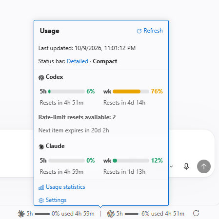
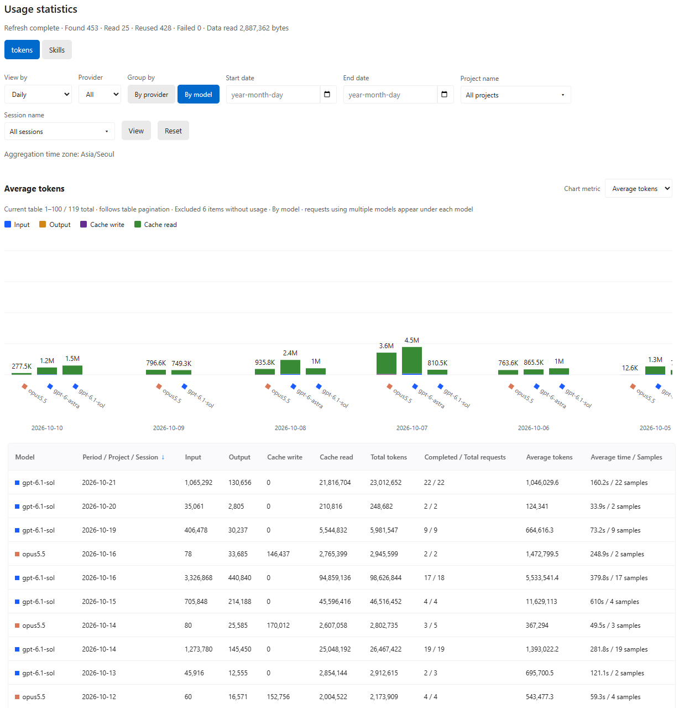

<p align="center">
  <a href="README.md">English</a> |
  <strong><a href="README.ko.md">한국어</a></strong> |
  <a href="README.zh.md">简体中文</a> |
  <a href="README.ja.md">日本語</a> |
  <a href="README.es.md">Español</a> |
  <a href="README.fr.md">Français</a>
</p>

# Agent Tracker

Claude·Codex의 현재 사용량과 리셋까지 남은 시간을 확인하고, AI 에이전트 사용 기록을 바탕으로 토큰 사용량과 작업 소요 시간을 추적하는 VS Code 확장입니다.

## 주요 기능

### 상태 표시줄에서 사용량 확인

- **현재 사용량** — VS Code 상태 표시줄에서 Claude·Codex의 구독 사용률과 리셋까지 남은 시간을 확인합니다.
- **상세 카드** — 클릭하면 5시간·주간 사용량, 리셋 시간, Codex 리셋권 등을 보여 주는 카드가 열립니다.
- **자동·수동 갱신** — 기본 15분 간격으로 조회하며, 새로고침 버튼으로 바로 갱신할 수 있습니다.

<p align="center">
  
</p>

### 대화·기간·모델별 토큰과 시간 비교

- **토큰·시간 통계** — 대화·일·월·프로젝트·모델별 총 토큰, 요청당 평균 토큰, 평균 소요 시간을 표와 차트로 확인합니다.
- **사용 기록** — 스킬·플러그인·서브에이전트·모델의 사용 횟수와 비율을 살펴봅니다.
- **이용 방식 개선** — 요청당 평균 토큰과 시간을 기준으로 모델 변경이나 스킬·플러그인 도입 전후를 비교하고, 에이전트 사용 방식을 조정합니다.

<p align="center">
  
</p>

카드의 **사용량 통계** 또는 명령 팔레트의 **Agent Tracker: 사용 통계 열기**로 진입합니다. 통계는 화면을 열 때 로컬 대화 로그에서 계산합니다.

## 설치 및 삭제

### 설치 및 업데이트

- **실행 환경:** Node.js **22.15 이상**, VS Code **1.101 이상**, 터미널에서 실행 가능한 `code` 명령
- **로그인:** 사용할 제공자의 CLI(Claude Code 또는 Codex CLI)에 먼저 로그인

설치와 업데이트 모두 같은 명령을 사용합니다.

```sh
npx agent-tracker-vscode@latest
```

완료되면 VS Code 명령 팔레트에서 **Developer: Reload Window**를 실행하세요.
Agent Tracker에 사용량 카드 클릭 동작 업데이트 안내가 표시되면 VS Code를 완전히 종료하고 잠시 후 다시 여세요. 지원되는 로컬 Windows·Linux 설치에서는 종료 후 패치가 자동으로 적용됩니다.

<details>
<summary>추가 옵션: 전역 설치 · 프로필 지정 · macOS 설정</summary>

**전역 설치·업데이트**

```sh
npm install -g agent-tracker-vscode@latest
agent-tracker-vscode
```

**특정 프로필에 설치:** VS Code에서 미리 만든 프로필 이름을 지정합니다.

```sh
npx agent-tracker-vscode@latest --profile "Work"
```

**macOS:** `code` 명령이 없으면 VS Code 명령 팔레트에서 **Shell Command: Install 'code' command in PATH**를 먼저 실행하세요.

</details>

### 삭제

VS Code 확장 목록에서 **Agent Tracker → 제거**를 선택하거나 다음 명령을 실행합니다.

```sh
code --uninstall-extension AgentTracker.agent-tracker
```

특정 프로필에 설치했다면 삭제 명령에도 `--profile "Work"`를 붙입니다. npm 전역 설치 패키지도 제거하려면 다음을 실행합니다.

```sh
npm uninstall -g agent-tracker-vscode
```

npm 패키지 삭제와 VS Code 확장 삭제는 별도입니다.

## VS Code 확장 설정

카드의 **설정**을 클릭하거나 VS Code 설정에서 `@ext:AgentTracker.agent-tracker`를 검색합니다.
아래 설정 키에는 모두 `agentTracker.` 접두사가 붙습니다.

| 설정 | 기본값 | 설명 |
| --- | --- | --- |
| `language` | `auto` | VS Code 언어 따르기. 한국어·영어·중국어 간체·일본어·스페인어·프랑스어 선택 가능 |
| `claude.enabled` / `codex.enabled` | `true` | 제공자별 사용량 조회·로그 통계 추적 및 상태 표시줄·카드·통계 표시 |
| `quota.refreshPolicy` | `automatic` | 자동 조회. `manual`은 새로고침을 누를 때만 조회 |
| `quota.pollingIntervalSeconds` | `900` | 자동 조회 간격(초). 최소 30초, 비활성 창에서는 일시 중지 |
| `display.percentage` | `used` | 막대와 숫자로 사용률 표시. 사용률은 왼쪽부터 차고, `remaining`은 잔여량이 오른쪽 끝부터 줄어듦 |
| `display.detail` | `detailed` | 7일·5시간 표시. `compact`는 5시간만 표시 |
| `display.colorMode` | `automatic` | 테마 색상 사용. `white`·`black`·`custom` 선택 가능 |
| `display.customColor` | `#ffffff` | `custom` 모드에서 사용할 HEX 색상 |
| `codex.showReserve` | `false` | 계정에서 제공하는 GPT Reserve 사용량 표시 |
| `codex.showResetCredits` | `true` | 계정에서 제공하는 리셋권 횟수와 다음 만료 시간 표시 |
| `usage.enabled` | `true` | 로컬 대화 로그의 토큰·시간 통계 사용 |
| `usage.skillsEnabled` | `true` | 스킬·플러그인·서브에이전트·모델 사용 횟수 집계 |
| `usage.showApiCosts` | `false` | API 추정 비용(USD) 표시. 구독 사용은 0으로 표시 |
| `usage.excludeEmptyUsage` | `true` | 모델과 토큰 정보가 모두 없는 요청을 차트·평균에서 제외. 표에는 유지 |
| `usage.timezone` | 시스템 시간대 | 일·월 통계의 기준 시간대. 예: `Asia/Seoul` |
| `dataHome` | `~` | `.claude`·`.codex`가 있는 공통 상위 폴더. 사용자 설정에서 지정 |
| `claude.cleanupPeriodDays` | `null` | Claude 로그 보존 일수. 1 이상 입력 시 Claude 설정에 반영, `null`은 기존 값 유지 |
| `codex.executable` | `codex` | Codex CLI 명령 또는 실행 파일 경로 |

**통계 계산 데이터 삭제** 명령으로 집계 결과를 초기화할 수 있습니다. 원본 대화 로그는 유지되며 통계를 다시 열면 재계산합니다.

## 변경 사항

<details open>
<summary>v0.3.0</summary>

- **통계 갱신 성능 개선** — JSONL 로그를 한 번 읽으며 집계하고, 큰 로그 묶음은 여러 파일을 병렬로 처리합니다. 중복 응답은 더 적합한 기록을 선택하고 기존 기여분과의 차이만 합계에 반영합니다.
- **DB 저장·조회 최적화** — 변경된 요청만 부분 갱신하고, 여러 세션의 저장과 일별 집계를 묶어 처리합니다. 중복 조회를 줄이고 표·도표·전체 행 수가 같은 조회 결과를 공유하도록 개선했습니다.
- **Codex 서브에이전트 사용량 합산** — 자식·손자 에이전트의 사용량을 부모 요청에 합산합니다. 요청 식별자가 없는 자식도 생성 이력으로 연결하며, 깊은 부모 관계와 순환·누락 처리를 개선했습니다.
- **이동한 로그의 통계 갱신 수정** — 원본 식별자와 내용이 확인된 로그는 새 경로로 연결하고 이전 경로 기록을 정리해, 이동 후 추가된 사용량도 계속 반영합니다.
- **사용량 카드·접근성 개선** — 호버로 전체 카드를 확인하고, 로컬 workbench 패치 적용 시 클릭으로 같은 카드를 고정·해제하는 동작을 복원했습니다. 접근성 요약은 간단 표시에서도 주간·5시간 잔량과 초기화 시간을 Codex부터 안내합니다.
- **사용량 조회 호환성 개선** — Claude·Codex 응답의 임의 100개 사용량 창 제한을 제거하고, 통신에 사용하는 확장 버전을 실제 설치 버전과 맞췄습니다.
- **미지원 언어 기본값 수정** — 지원하지 않는 VS Code 언어에서는 영어로 표시합니다.
- **확장 아이콘 교체** — 새 아이콘을 적용하고 이미지 파일 크기를 줄였습니다.

[v0.2.0 대비 알고리즘 구간별 개선량과 측정 한계](docs/Performance-v0.3.0.ko.md)

</details>

<details>
<summary>v0.2.0</summary>

- **DB 성능 개선** — 인덱스로 기간·프로젝트별 조회를 최적화하고, 일별 사전 집계(rollup)로 모델별 통계와 평균 계산을 개선했습니다.
- **Codex 압축 로그 지원** — Codex가 Zstd(`.jsonl.zst`)로 압축한 오래된 대화도 읽어 통계에 포함합니다.
- **원본 삭제 후 통계 보존** — Claude의 오래된 대화 자동 삭제 등에 대비해, 원본이 삭제되어도 DB에 저장된 유효한 통계를 기본으로 유지합니다.
- **도표 가독성 개선** — 제공자별 보기에도 제공자 색상을 표시하고, 표 헤더를 눌러 오름차순·내림차순으로 정렬할 수 있습니다.
- **페이지당 행 수 조절** — 통계 화면에서 페이지당 표시할 행 수를 조절할 수 있습니다.

</details>

## 사용량 통계 수집 방식

프로젝트는 작업 폴더입니다. 세션은 같은 채팅에서 이어진 대화의 묶음입니다. 대화는 사용자 메시지 한 번부터 메인 에이전트의 답변까지이며, 부모가 확인된 서브에이전트의 사용량을 포함합니다. Agent Tracker는 일반 JSONL과 Codex의 Zstd 압축 JSONL을 읽습니다.

### 로그에서 읽는 필드

| 용도 | Claude | Codex |
| --- | --- | --- |
| 세션·스레드 식별 | 메인 로그의 `sessionId`를 사용하며, 값이 없으면 파일명을 사용합니다. 서브에이전트는 상위 세션 폴더와 파일명으로 구분합니다. | `session_meta`의 `payload.id` 또는 `token_usage_record`의 `payload.thread_id`로 스레드를 식별합니다. `payload.session_id`가 없으면 스레드 ID를 세션 ID로 사용합니다. |
| 모델·응답 식별 | `assistant` 행의 `message.model`, `message.id`, `requestId`를 읽습니다. `isApiErrorMessage`는 토큰이 0인 오류 응답을 거르는 데 사용합니다. | 사용량 행 또는 세션·턴 문맥의 `payload.model`을 읽습니다. `payload.turn_id`와 `payload.response_id`로 응답을 식별합니다. |
| 입력·출력·캐시 토큰 | `message.usage`의 `input_tokens`, `output_tokens`, `cache_read_input_tokens`, `cache_creation_input_tokens`를 읽습니다. | `payload.usage`의 `input_tokens`와 `output_tokens`를 읽습니다. 캐시는 `cached_input_tokens`와 `cache_write_input_tokens`, 또는 `input_tokens_details.cached_tokens`와 `input_tokens_details.cache_write_tokens`에서 읽습니다. |
| 누계·부모 참조 | — | `payload.thread_token_usage`, `payload.turn_token_usage`, 구형 `token_count` 이벤트의 `payload.info.total_token_usage`와 `payload.info.last_token_usage`를 읽습니다. `session_meta`에서 `forked_from_id` 또는 직접·중첩 `parent_thread_id`를 확인합니다. |
| 시각 | 행의 `timestamp`를 읽습니다. | 행의 `timestamp` 또는 `payload.timestamp`와 이벤트의 `payload.started_at`, `payload.completed_at`을 읽습니다. |

### 파싱과 일별 집계

1. JSONL을 줄 단위로 처리해 정해진 필드 경로의 값만 골라냅니다. 한 줄이 여러 청크에 걸치면 JSON 문법 상태와 선택한 값을 이어서 처리합니다. 이미지 Base64는 읽는 중에 건너뜁니다.
2. Claude는 같은 세션의 `(message.id, requestId)`, Codex는 같은 스레드의 `(turn_id, response_id)`로 중복을 확인합니다. Claude의 같은 메시지에 확인된 요청 ID가 한 종류면 요청 ID가 빠진 기록도 함께 비교합니다. 중복된 응답은 입력과 출력 토큰의 합이 가장 큰 기록을 한 번 반영합니다. Claude는 일반 입력에 캐시 읽기·쓰기를 더하고 Codex는 기록된 입력 총량을 사용합니다.
3. 구형 Codex 로그는 부모 스레드와 대조해 복사된 앞부분을 제외하고, 남은 누계에서 확인된 증가분을 더합니다. 스레드 누계에 응답 합계로 설명되지 않는 증가분이 있으면 턴 누계나 구형 기록으로 확인한 뒤 합산합니다.
4. 대화 시작 시각을 통계 시간대의 날짜로 바꿔 일별로 합칩니다. 완료된 대화를 세고, 평균 시간은 소요 시간이 확인된 완료 대화에서 계산합니다.

### SQLite에 저장하는 테이블

| 테이블 | 저장 내용 |
| --- | --- |
| `source_file` | 원본 경로, 세션·스레드 ID, 수정 시각, 파서 버전, 처리 상태와 원본 소실 여부를 기록합니다. |
| `usage_request_daily` | 제공자·세션·프로젝트·현지 날짜별 토큰·시간·비용 합계와 표본 수를 저장합니다. |
| `usage_model_daily` | 같은 일별 키에 모델을 추가해 모델별 합계와 표본 수를 저장합니다. |
| `projects`, `sessions` | 프로젝트와 세션의 표시 이름을 저장합니다. |
| `session_billing` | 제공자와 세션별로 사용자가 지정한 결제 유형을 저장합니다. |
| `usage_rollup_meta` | 일별 집계에 적용한 시간대와 형식 버전을 저장합니다. |
| `usage_capability_daily` | 이전 스키마에서 이관한 도구 사용 횟수를 저장하고 도구 통계에서 조회합니다. |

통계 화면은 선택한 기간과 그룹에 맞게 제공자 또는 모델의 일별 행을 합칩니다. 평균은 저장된 합계와 집계에 해당하는 표본 수로 계산합니다.
