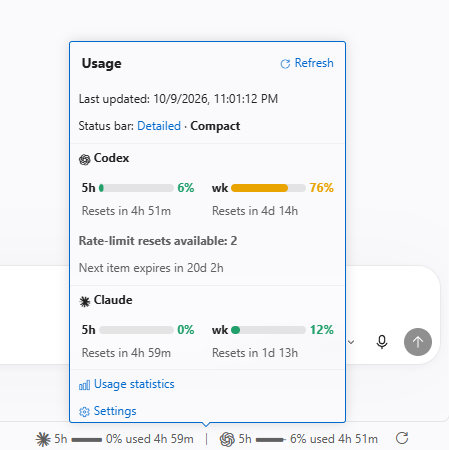
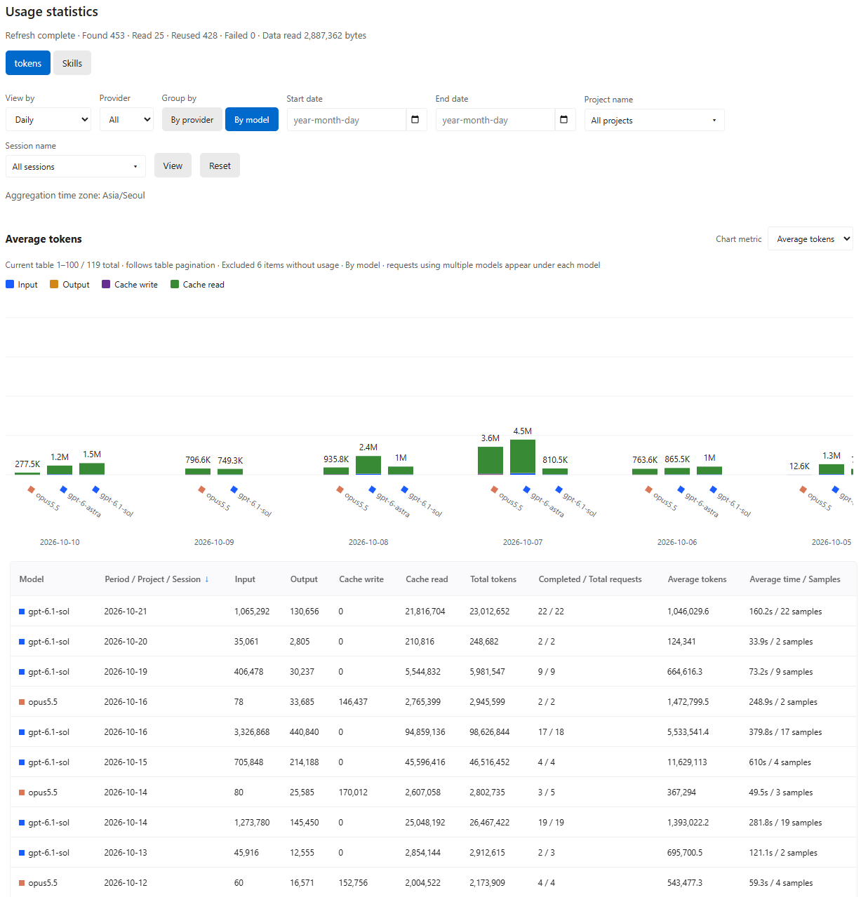

<p align="center">
  <strong><a href="https://github.com/lsc892/Agent-Tracker/blob/main/README.md">English</a></strong> |
  <a href="https://github.com/lsc892/Agent-Tracker/blob/main/README.ko.md">한국어</a> |
  <a href="https://github.com/lsc892/Agent-Tracker/blob/main/README.zh.md">简体中文</a> |
  <a href="https://github.com/lsc892/Agent-Tracker/blob/main/README.ja.md">日本語</a> |
  <a href="https://github.com/lsc892/Agent-Tracker/blob/main/README.es.md">Español</a> |
  <a href="https://github.com/lsc892/Agent-Tracker/blob/main/README.fr.md">Français</a>
</p>

# Agent Tracker

A VS Code extension that shows current Claude and Codex usage and time until reset, and tracks token usage and task duration from AI agent usage records.

## Features

### Check usage from the status bar

- **Current usage** — See Claude and Codex subscription usage and time until reset in the VS Code status bar.
- **Details card** — Click to open a card with 5-hour and weekly usage, reset times, and available Codex usage resets.
- **Automatic and manual refresh** — Usage refreshes every 15 minutes by default. Use the refresh button for an immediate update.

<p align="center">
  
</p>

### Compare tokens and time by conversation, period, and model

- **Token and time statistics** — View total tokens, average tokens per request, and average duration in tables and charts by conversation, day, month, project, or model.
- **Usage history** — See usage counts and proportions for skills, plugins, subagents, and models.
- **Improve your workflow** — Compare average tokens and time per request before and after changing models or adopting skills and plugins to refine how you use agents.

<p align="center">
  
</p>

Open **Usage statistics** from the card or run **Agent Tracker: Open Usage Statistics** from the Command Palette. Statistics are calculated from local conversation logs when you open the view.

## Installation and removal

### Install and update

- **Requirements:** Node.js **22.15+**, VS Code **1.101+**, and the `code` command available in your terminal
- **Sign-in:** Sign in through the CLI for each provider you use: Claude Code or the Codex CLI

Use the same command to install or update:

```sh
npx agent-tracker-vscode@latest
```

When it finishes, run **Developer: Reload Window** from the VS Code Command Palette.
If Agent Tracker prompts you to update the usage card's click behavior, fully quit VS Code, wait a moment, and reopen it. Agent Tracker applies the patch on exit on supported local Windows and Linux installations.

<details>
<summary>More options: global install · profiles · macOS setup</summary>

**Global install and update**

```sh
npm install -g agent-tracker-vscode@latest
agent-tracker-vscode
```

**Install into a profile:** Provide the name of a profile you have already created in VS Code.

```sh
npx agent-tracker-vscode@latest --profile "Work"
```

**macOS:** If `code` is unavailable, first run **Shell Command: Install 'code' command in PATH** from the VS Code Command Palette.

</details>

### Uninstall

Select **Agent Tracker → Uninstall** in the VS Code Extensions view, or run:

```sh
code --uninstall-extension AgentTracker.agent-tracker
```

If you installed into a specific profile, add `--profile "Work"` to the uninstall command. To also remove the globally installed npm package:

```sh
npm uninstall -g agent-tracker-vscode
```

The npm package and the VS Code extension are uninstalled separately.

## VS Code extension settings

Click **Settings** in the card or search for `@ext:AgentTracker.agent-tracker` in VS Code Settings.
All setting keys below use the `agentTracker.` prefix.

| Setting | Default | Description |
| --- | --- | --- |
| `language` | `auto` | Follow the VS Code language. Choose Korean, English, Simplified Chinese, Japanese, Spanish, or French |
| `claude.enabled` / `codex.enabled` | `true` | Track subscription usage and logs, and show each provider in the status bar, usage card, and statistics |
| `quota.refreshPolicy` | `automatic` | Refresh automatically. `manual` fetches usage only when you click refresh |
| `quota.pollingIntervalSeconds` | `900` | Automatic refresh interval in seconds. Minimum 30; pauses in inactive windows |
| `display.percentage` | `used` | Bars and numbers show usage. Used bars fill from the left. `remaining` bars shrink from the right |
| `display.detail` | `detailed` | Show 7-day and 5-hour usage. `compact` shows only 5-hour usage |
| `display.colorMode` | `automatic` | Use the theme color. Also supports `white`, `black`, and `custom` |
| `display.customColor` | `#ffffff` | HEX color for `custom` mode |
| `codex.showReserve` | `false` | Show GPT Reserve usage when available for your account |
| `codex.showResetCredits` | `true` | Show available usage resets and their next expiry when provided by your account |
| `usage.enabled` | `true` | Enable token and time statistics from local conversation logs |
| `usage.skillsEnabled` | `true` | Count skill, plugin, subagent, and model usage |
| `usage.showApiCosts` | `false` | Show estimated API costs in USD. Subscription usage is shown as zero |
| `usage.excludeEmptyUsage` | `true` | Exclude requests with neither model nor token information from charts and averages; keep them in tables |
| `usage.timezone` | System time zone | Time zone for daily and monthly statistics. Example: `Asia/Seoul` |
| `dataHome` | `~` | Shared parent folder containing `.claude` and `.codex`. Set in user settings |
| `claude.cleanupPeriodDays` | `null` | Claude log retention in days. Values of 1 or more update Claude settings; `null` preserves the existing value |
| `codex.executable` | `codex` | Codex CLI command or executable path |

Use **Agent Tracker: Delete Statistics Data** to clear aggregated statistics. Original conversation logs are preserved, and statistics are recalculated when you reopen the view.

## Release notes

<details open>
<summary>v0.4.1</summary>

- **Session billing** — The billing selector now defaults to **All**. Choose **All** to clear a manual override and calculate estimated costs from the billing methods recorded in the logs.
- **JSONL parsing** — Codex entries with extra top-level fields fall back to the general parser. Tool arguments, subagent results, and optional token checkpoints with invalid formats are skipped.
- **Claude credentials** — Simplified credential file validation and reading on Windows and macOS, preserving cancellation and the macOS Keychain fallback.
- **Usage statistics time zone** — Simplified validation of the time zone setting. Invalid values still fall back to the default and display a warning.
- **Benchmark documentation** — Standardized how percentage changes are reported in the usage statistics benchmarks.

</details>

<details>
<summary>v0.4.0</summary>

- **Statistics first view** — The default and reset range now cover the last 30 days. The first table loads from SQLite after the refresh completes. If the refresh fails or is canceled, you can retry it.
- **Completed conversation statistics** — Daily and monthly totals use the conversation start date. Counts and average tokens use completed conversations, and average duration uses completed conversations with a known duration.
- **Incremental log refresh** — Use modification times to identify new or changed logs and read related logs when needed to rebuild affected sessions. A move is handled as a new file and a missing source, with the retention setting applied to the old path.
- **JSONL parsing and token aggregation** — Read only the fields needed for statistics, reuse buffers for long lines, and merge duplicate responses during collection. Codex aggregation excludes copied history and adds usage verified against turn or thread totals.
- **SQLite daily storage** — Migrate existing usage to daily provider, model, and tool totals and write only changed rows. The Skills tab loads its four categories in one query, and cost and row-count queries do less repeated work.
- **Usage card click behavior** — Fix click-to-open, pin, and dismiss behavior. On supported local Windows and Linux installations, Agent Tracker applies the update after VS Code fully exits.

In a benchmark with 10,000 synthetic conversations and an empty database, the time from initial collection to the first statistics table fell from **879.6 to 701.6 ms (-20.2%)**. [Usage statistics benchmark against v0.3.1 (Korean)](https://github.com/lsc892/Agent-Tracker/blob/main/docs/benchmarks/success/2026-11-28/MainDevDashboardAB-2026-11-28.md)

</details>

<details>
<summary>v0.3.1</summary>

- **Quick date ranges** — Choose the last 7, 30, or 90 days, all time, or custom dates. The default is the last 7 days including today, and custom dates provide start/end inputs and calendars.
- **Provider controls** — The Claude and Codex enabled settings each control usage tracking and visibility in the status bar, usage card, and statistics.
- **Usage and remaining gauges** — Bars and percentages follow the selected display mode. Usage bars fill from the left, and remaining bars shrink from the right.
- **Moved log verification** — Require a content match to reconnect a log at a new path. This protects stored usage when the operating system reuses a deleted file's identifier.
- **Average-token chart calculation** — Compute input, output, and cache component averages only for the average-token chart.
- **npm package README** — Include the main README with working screenshots and documentation links in the npm installer package.

</details>

<details>
<summary>v0.3.0</summary>

- **Faster statistics refresh** — Read and aggregate JSONL logs in a single pass, and process multiple files in parallel for large log sets. Duplicate responses select the preferred record and update totals only by the difference in contributions.
- **Database writes and queries** — Update only changed requests and batch writes and daily rollups across sessions. Fewer duplicate queries are needed, and tables, charts, and total row counts share the same query results.
- **Codex subagent usage** — Combine child and nested subagent usage into the parent request. Creation records link children without request identifiers, with improved handling of deep parent chains, cycles, and missing parents.
- **Moved log updates** — Verify source identity and content before linking a log at its new path and removing the old path record, so usage added after a move continues to update statistics.
- **Usage card and accessibility** — Restore the full card on hover and, with the local workbench patch, pin or dismiss the same card by clicking. Accessible summaries announce weekly and 5-hour remaining usage and reset times with Codex first, even in compact mode.
- **Usage query compatibility** — Remove the arbitrary 100-window limit from Claude and Codex responses and use the installed extension version in communication metadata.
- **Unsupported language fallback** — Display English when the VS Code language is unsupported.
- **Updated extension icon** — Replace the icon and reduce its image file size.

[Algorithm changes, measured gains over v0.2.0, and limitations (Korean)](https://github.com/lsc892/Agent-Tracker/blob/main/docs/Performance-v0.3.0.ko.md)

</details>

<details>
<summary>v0.2.0</summary>

- **Database performance** — Indexes optimize queries by period and project, while daily rollups improve model statistics and average calculations.
- **Compressed Codex logs** — Statistics now include older conversations that Codex has compressed with Zstd (`.jsonl.zst`).
- **Statistics retention** — Valid statistics stored in the database are kept by default after source conversations are deleted, including by Claude's automatic cleanup of older conversations.
- **Chart readability** — Provider views now show provider colors, and table headers let you sort in ascending or descending order.
- **Adjustable rows per page** — Choose how many rows to display per page in the statistics view.

</details>

## How usage statistics are collected

A project is a working folder. A session is one chat containing a series of conversations. One conversation runs from a user message to the main agent’s reply and includes usage from subagents linked to it. Agent Tracker reads JSONL logs, including Zstd-compressed Codex logs.

### Log fields

| Purpose | Claude | Codex |
| --- | --- | --- |
| Session and thread | `sessionId` in the main log, with the filename as a fallback. Subagent logs use their parent session folder and filename. | `payload.id` in `session_meta` or `payload.thread_id` in `token_usage_record`. If `payload.session_id` is missing, use the thread ID as the session ID. |
| Model and response | `message.model`, `message.id`, and `requestId` on `assistant` rows. `isApiErrorMessage` helps filter zero-token errors. | `payload.model` on usage rows or in session or turn context. `payload.turn_id` and `payload.response_id` identify the response. |
| Input, output, and cache | `message.usage` provides `input_tokens`, `output_tokens`, `cache_read_input_tokens`, and `cache_creation_input_tokens`. | `payload.usage` provides `input_tokens` and `output_tokens`. Cache counts come from `cached_input_tokens` and `cache_write_input_tokens` or from `input_tokens_details.cached_tokens` and `input_tokens_details.cache_write_tokens`. |
| Cumulative counters and parent references | — | `payload.thread_token_usage`, `payload.turn_token_usage`, and the legacy `payload.info.total_token_usage` and `payload.info.last_token_usage` on `token_count` events. `session_meta` provides `forked_from_id` or `parent_thread_id`, including nested parent references. |
| Time | Row `timestamp`. | Row or `payload.timestamp`, plus `payload.started_at` and `payload.completed_at` on events. |

### From log rows to daily totals

1. Select known field paths line by line. For lines spanning read chunks, keep the selected fields and JSON syntax state across chunk boundaries. Skip image Base64 while reading.
2. Count each response once. Claude matches `(message.id, requestId)` within a session, while Codex matches `(turn_id, response_id)` within a thread. If a Claude message has only one known request ID, also compare records missing that ID. For duplicates, use the record with the highest input-plus-output token count. Claude adds cache reads and writes to its input count, while Codex uses the logged input total.
3. For Codex, compare legacy records with the parent thread to skip copied history and sum verified increases in the remaining counters. Use turn counters or legacy records to verify any extra usage suggested by a thread counter before adding it.
4. Group usage by the conversation start date in the statistics time zone. Count completed conversations and calculate average duration from the ones with a recorded duration.

### SQLite tables

| Table | What it stores |
| --- | --- |
| `source_file` | Log paths, session and thread IDs, modification times, parser versions, and processing or missing-file status. |
| `usage_request_daily` | Token, time, and cost totals and sample counts keyed by provider, session, project, and local date. |
| `usage_model_daily` | The daily totals and sample counts with a model key added. |
| `projects`, `sessions` | Display names for project and session keys. |
| `session_billing` | The billing mode selected for each provider and session. |
| `usage_rollup_meta` | The time zone and format version used for daily aggregation. |
| `usage_capability_daily` | Daily usage counts for skills, subagents, plugins, and models. |

The statistics view filters and groups the daily provider or model rows for the selected period. It uses the stored totals and sample counts to calculate averages.
