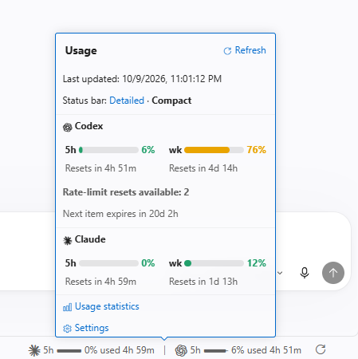
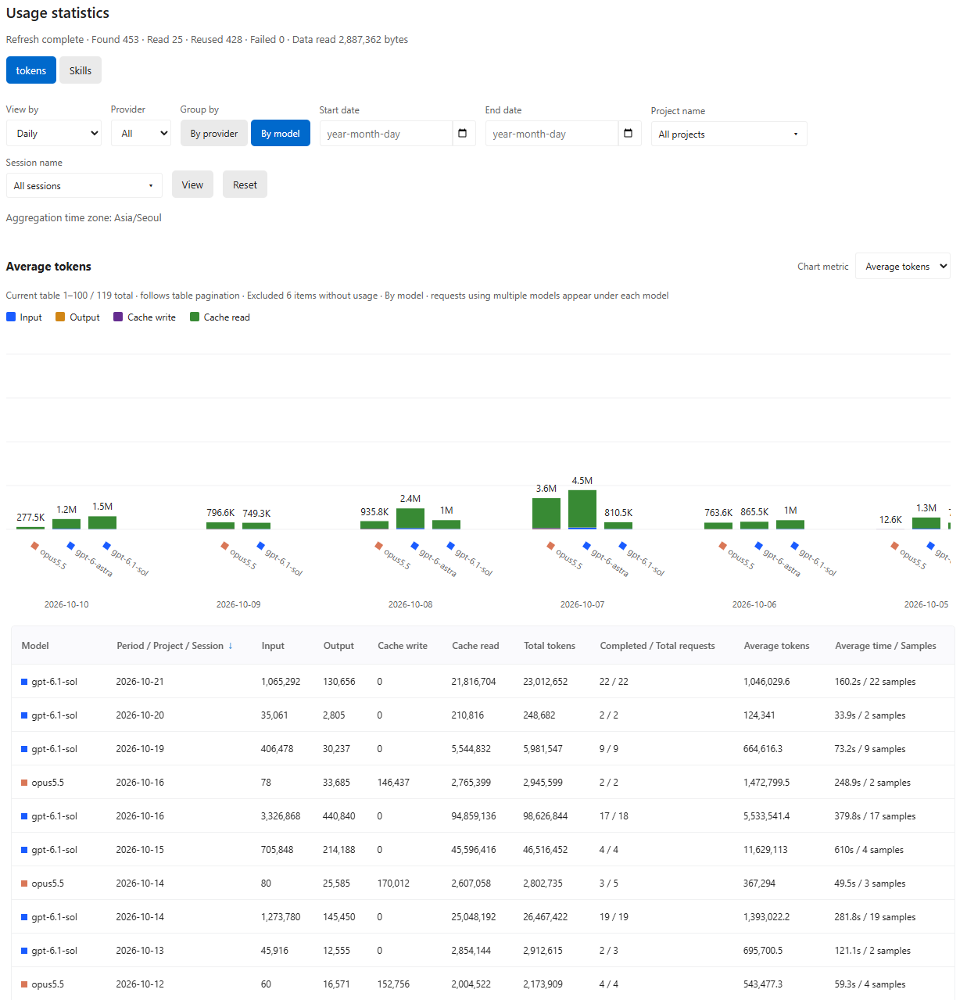

<p align="center">
  <a href="README.md">English</a> |
  <a href="README.ko.md">한국어</a> |
  <strong><a href="README.zh.md">简体中文</a></strong> |
  <a href="README.ja.md">日本語</a> |
  <a href="README.es.md">Español</a> |
  <a href="README.fr.md">Français</a>
</p>

# Agent Tracker

在 VS Code 中查看 Claude 和 Codex 的当前用量及重置倒计时，并通过 AI 智能体使用记录追踪 Token 消耗与任务耗时的扩展。

## 主要功能

### 在状态栏查看用量

- **当前用量** — 在 VS Code 状态栏查看 Claude 和 Codex 的订阅用量比例及重置倒计时。
- **详情卡片** — 点击即可查看 5 小时和每周用量、重置时间，以及 Codex 可用的用量重置次数。
- **自动与手动刷新** — 默认每 15 分钟查询一次，也可点击刷新按钮立即更新。

<p align="center">
  
</p>

### 按对话、时间段和模型比较 Token 与耗时

- **Token 与耗时统计** — 通过表格和图表，按对话、日、月、项目或模型查看总 Token 数、每次请求的平均 Token 数和平均耗时。
- **使用记录** — 查看技能、插件、子代理和模型的使用次数及占比。
- **改进使用方式** — 比较更换模型或引入技能、插件前后的每次请求平均 Token 数与耗时，调整代理的使用方式。

<p align="center">
  
</p>

点击卡片中的 **使用统计**，或在命令面板运行 **Agent Tracker：打开使用统计**。打开统计页面时，扩展会根据本地对话日志计算统计数据。

## 安装与卸载

### 安装与更新

- **运行环境：** Node.js **22.15 及以上**、VS Code **1.101 及以上**，且终端中可以运行 `code` 命令
- **登录：** 请先通过所用提供商的 CLI（Claude Code 或 Codex CLI）登录

安装和更新均使用以下命令：

```sh
npx agent-tracker-vscode@latest
```

完成后，在 VS Code 命令面板运行 **Developer: Reload Window**。

<details>
<summary>更多选项：全局安装 · 配置文件 · macOS 设置</summary>

**全局安装与更新**

```sh
npm install -g agent-tracker-vscode@latest
agent-tracker-vscode
```

**安装到指定配置文件：** 使用已在 VS Code 中创建的配置文件名称。

```sh
npx agent-tracker-vscode@latest --profile "Work"
```

**macOS：** 若没有 `code` 命令，请先在 VS Code 命令面板运行 **Shell Command: Install 'code' command in PATH**。

</details>

### 卸载

在 VS Code 扩展列表中选择 **Agent Tracker → 卸载**，或运行：

```sh
code --uninstall-extension AgentTracker.agent-tracker
```

如果安装时指定了配置文件，请在卸载命令中也添加 `--profile "Work"`。如需同时删除全局安装的 npm 包，请运行：

```sh
npm uninstall -g agent-tracker-vscode
```

npm 包和 VS Code 扩展需要分别卸载。

## VS Code 扩展设置

点击卡片中的 **设置**，或在 VS Code 设置中搜索 `@ext:AgentTracker.agent-tracker`。
以下设置键均以 `agentTracker.` 为前缀。

| 设置 | 默认值 | 说明 |
| --- | --- | --- |
| `language` | `auto` | 跟随 VS Code 语言。可选择韩语、英语、简体中文、日语、西班牙语或法语 |
| `claude.enabled` / `codex.enabled` | `true` | 分别启用各提供商的用量查询与日志统计 |
| `quota.refreshPolicy` | `automatic` | 自动查询。`manual` 仅在点击刷新时查询 |
| `quota.pollingIntervalSeconds` | `900` | 自动查询间隔（秒），最小 30 秒；非活动窗口中暂停 |
| `display.percentage` | `used` | 进度条和数字显示已用比例。已用进度从左侧填充。`remaining` 的剩余进度从右端减少 |
| `display.detail` | `detailed` | 显示 7 天和 5 小时用量；`compact` 仅显示 5 小时用量 |
| `display.colorMode` | `automatic` | 使用主题颜色，也可选 `white`、`black` 或 `custom` |
| `display.customColor` | `#ffffff` | `custom` 模式使用的 HEX 颜色 |
| `codex.showReserve` | `false` | 显示账户提供的 GPT Reserve 用量 |
| `codex.showResetCredits` | `true` | 显示账户提供的用量重置次数及下一次到期时间 |
| `usage.enabled` | `true` | 启用本地对话日志的 Token 与耗时统计 |
| `usage.skillsEnabled` | `true` | 统计技能、插件、子代理和模型的使用次数 |
| `usage.showApiCosts` | `false` | 显示估算的 API 费用（美元），订阅使用显示为 0 |
| `usage.excludeEmptyUsage` | `true` | 图表和平均值排除既无模型信息也无 Token 信息的请求，表格中仍保留 |
| `usage.timezone` | 系统时区 | 日、月统计的时区，例如 `Asia/Seoul` |
| `dataHome` | `~` | 包含 `.claude` 和 `.codex` 的共同父文件夹，在用户设置中指定 |
| `claude.cleanupPeriodDays` | `null` | Claude 日志保留天数。大于等于 1 时写入 Claude 设置；`null` 保留现有值 |
| `codex.executable` | `codex` | Codex CLI 命令或可执行文件路径 |

运行 **Agent Tracker：删除统计数据** 可清空汇总结果。原始对话日志会保留，重新打开统计页面时会重新计算。

## 更新说明

<details open>
<summary>v0.2.1</summary>

- **快速选择统计时间段** — 可选择最近 7 天、30 天、90 天、全部时间或自定义日期。默认显示含今天在内的最近 7 天，自定义时显示起止日期输入框和日历。
- **统计刷新性能优化** — 单次读取 JSONL 日志即可完成聚合，大量日志文件可并行处理。重复响应会选取更合适的记录，仅将贡献值的差额计入总量。
- **数据库写入与查询优化** — 仅更新发生变化的请求，批量处理多个会话的写入和每日聚合。减少重复查询，让表格、图表和总行数共享同一查询结果。输入、输出及缓存分项的平均值在平均 token 图表需要时计算，减少其他图表的聚合开销。
- **Codex 子代理用量合并** — 将子代理及嵌套子代理的用量合并到父请求。通过创建记录关联缺少请求标识的子代理，并改进深层父子关系、循环和父代理缺失的处理。
- **修复日志移动后的统计更新** — 验证源标识和内容后关联新路径并清理旧路径记录，使移动后新增的用量仍可计入统计。即使操作系统将已删除文件的标识符重新分配给其他文件，也会通过内容验证保护已保存的用量。
- **统一提供商控制** — Claude 和 Codex 的启用设置分别控制各自的用量跟踪，以及状态栏、用量卡片和统计中的显示。
- **修复用量与剩余量进度条** — 进度条和百分比遵循所选显示模式。用量从左侧增加，剩余量从右端减少。
- **用量卡片与无障碍改进** — 恢复悬停显示完整卡片的行为；应用本地 workbench 补丁后，可点击固定或关闭同一卡片。即使使用简洁模式，无障碍摘要也会优先播报 Codex 的每周、5 小时剩余用量和重置时间。
- **用量查询兼容性改进** — 移除 Claude 和 Codex 响应中最多 100 个用量窗口的人为限制，并在通信元数据中使用实际安装的扩展版本。
- **修复不支持语言的默认显示** — VS Code 使用不支持的语言时，默认显示英语。
- **更新扩展图标** — 替换图标并缩小图片文件体积。

[相较 v0.2.0 的分阶段算法改进、实测收益与局限（韩语）](docs/Performance-v0.3.0.ko.md)

</details>

<details>
<summary>v0.2.0</summary>

- **数据库性能优化** — 通过索引优化按时间段和项目的查询，并通过每日预聚合（rollup）改进按模型统计和平均值计算。
- **支持 Codex 压缩日志** — 将 Codex 使用 Zstd（`.jsonl.zst`）压缩的历史对话纳入统计。
- **保留已删除对话的统计** — 原始对话被删除后，默认保留数据库中的有效统计，避免 Claude 自动清理历史对话导致统计丢失。
- **图表可读性改进** — 按提供商查看时也显示对应颜色，点击表头即可切换升序或降序。
- **调整每页行数** — 可在统计视图中调整每页显示的行数。

</details>

<br><br>

[使用与开发参考（韩语）](docs/refrences/Development.ko.md)
