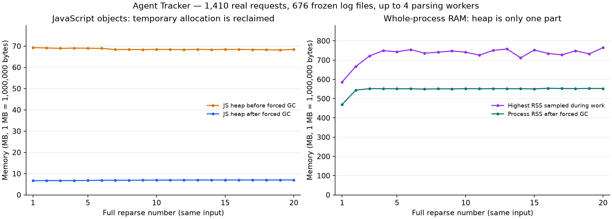
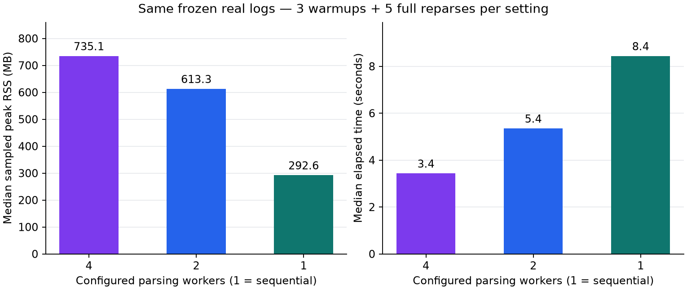

# 반복 통계 집계의 메모리 수명과 Worker 수별 RAM 관측

2026-11-16, Asia/Seoul. 사용자는 같은 데이터를 반복 집계한 뒤 GC 전후 힙·버퍼와 힙 스냅샷을 비교하고, GC·힙의 의미와 RAM 최적화 방향을 설명해 달라고 요청했다. 이번 요청에 한정한 메모리 진단을 실행했다. 제품 코드·기본 Worker 수·설치된 확장·사용자 통계 DB는 변경하지 않았다.

**판정:** 관측한 반복 집계·취소·클라이언트 종료에서 주요 집계 객체나 버퍼가 누적되는 누수 증거는 발견하지 못했다. 다만 실제 원본을 최대 4개 Worker로 재파싱하는 동안 프로세스 RSS는 약 765MB까지 관측됐다. 과거의 266MB는 현재 버전의 상한으로 사용할 수 없다. 모든 수치는 MB=1,000,000byte다.

**입력과 측정 방법**

- 현재 기본 경로의 실제 로그를 관측한 크기까지만 읽어 고정 사본으로 만들었다. 676파일·407,412,679byte이며 603파일은 Zstd 압축이다. 요청 1,410개·2,928,786,206토큰으로 집계됐다. 원본 로그는 쓰지 않았으며 제목 metadata도 사본을 사용했다.
- 합성 10,000요청은 100파일·5,637,210byte, 합성 100요청은 10파일·55,700byte다. 제공자별 절반이며 생성기 산식의 요청·토큰 합계와 대조했다.
- 각 입력을 별도 프로세스에서 예열 3회 후 같은 내용 전면 재파싱 20회, 무변경 갱신 20회, 파싱 진입 직후 취소 5회 실행했다. 마지막 정상 재파싱으로 복구도 확인했다. 재파싱은 사본 DB의 `manifest.parser_version`만 무효화했다. 원본·사본 로그 본문은 변경하지 않았다.
- 같은 프로세스와 DB를 유지한 채 각 회차의 GC 전후 `heapUsed`·`heapTotal`·`external`·`arrayBuffers`·RSS를 기록했다. GC는 이벤트 루프에 제어를 돌려준 뒤 major/sync로 두 번 요청했다. 진단만을 위한 강제 GC이며 제품에 추가하지 않았다.
- 작업 중 RSS는 10ms 타이머와 진행 알림·집계·저장 경계에서 표본을 수집했다. 동기 구간 사이의 더 짧은 피크는 놓칠 수 있으므로 이 값은 보장 상한이 아니다. 경과 시간에는 관측 비용이 포함되며 일반 화면 응답 시간과 다르다.
- GC 뒤 `v8.queryObjects(..., {format:'count'})`로 집계 클래스 인스턴스를 셌다. 힙 스냅샷은 별도 프로세스에서 실제·합성 10,000요청을 각각 예열한 뒤 20회 재파싱 전후에 생성했다. 스냅샷 생성·분석이 기본 RSS 측정을 오염시키지 않도록 분리했다.
- 별도로 실제 `SummaryClient`의 생성·초기화·갱신·조회·구독 해제·종료를 합성 100요청으로 20회 반복했다.
- 환경은 Node v24.14.1·Windows·AMD Ryzen 5 7500F, 논리 CPU 12개다. SQLite/V8 버전·Git revision·실행기 해시·모든 표본은 [원시 메모리 기록](SummaryMemory-2026-11-16.json)에 남겼다.

**반복 전면 재파싱 결과**

| 입력 | 완료 직후 GC 전 힙 중앙값 | GC 후 힙 범위 | 재파싱 중 관측 최고 RSS |
| --- | ---: | ---: | ---: |
| 실제 1,410요청 | 68.44MB | 6.68–7.04MB | 764.69MB |
| 합성 10,000요청 | 52.60MB | 6.75–7.11MB | 251.89MB |
| 합성 100요청 | 10.83MB | 7.08–7.40MB | 62.75MB |

실제 데이터의 1회차→20회차 GC 후 힙은 6.680→7.037MB다. 마지막 5회 평균은 7.019MB였고, 회차마다 큰 집계 상태가 계속 쌓이는 모습은 나타나지 않았다. 합성 10,000요청은 6.752→7.109MB, 100요청은 7.077→7.397MB였다. 초기보다 수백 KB가 늘었으므로 증가가 전혀 없다고 표현하지 않는다. 진단 코드·런타임의 초기화도 측정에 포함된다.

세 입력의 GC 후 `arrayBuffers`는 매 회차 27,131byte로 같았다. 각 단계 종료 후 `ScanState`·`SourceReaderPool`·`SourceWinners`·`SourceEvidence`·`StreamingAggregation`·`Winners`·`MemoryStore` 인스턴스는 모두 0이었다. 실제 입력은 재파싱마다 파일 Worker 4개를 생성했으며 갱신 후 활성 Worker는 항상 0이었다. 두 합성 입력은 작은 파일의 순차 경로를 사용했다. 고정 SQL 캐시는 16개로 유지됐다.

원본 요청 facts의 해시와 요청·토큰 합계는 같은 입력에서 모두 일치했고 실패는 0이었다. 무변경 갱신은 세 입력 모두 본문 읽기·파싱 0이었다. 취소는 파싱 진입 후 첫 이벤트 루프 양보 시 요청한 것이며 대용량 파일의 임의 중간 위치 취소를 대표하지 않는다.

힙이 약 7MB로 줄었다고 프로세스 전체 RAM도 7MB가 되는 것은 아니다. 실제 재파싱의 GC 후 RSS는 약 470–554MB였다. 무변경 갱신 단계에서는 약 363MB까지 내려갔다. 런타임·네이티브 할당·재사용을 위해 보유한 공간을 포함하므로 RSS와 JS의 사용 중인 힙은 구분한다. 이 측정만으로 네이티브 영역의 모든 보유 메모리의 원인을 확정하지 않는다.

**힙 스냅샷과 클라이언트 종료**

실제·합성 10,000요청의 두 스냅샷에서 다음 개수 변화가 같았다. 아래는 스냅샷의 객체 이름별 개수이며 프로토타입도 포함할 수 있어 활성 네이티브 리소스 수로 해석하지 않는다.

| 객체 | 20회 재파싱 전 | 후 |
| --- | ---: | ---: |
| Map | 32 | 32 |
| Set | 30 | 30 |
| Array | 348 | 347 |
| Promise | 7 | 6 |
| StatementSync | 17 | 17 |

주요 집계 클래스는 양쪽 스냅샷에도 남지 않았다. 전체 노드는 실제 데이터에서 72,347→73,205, 합성 10,000요청에서 80,338→72,367이었다. 전체 노드 개수만으로 누수 여부를 단정하지 않는다. 원시 스냅샷은 비공개 캐시에 보존하고 공개 JSON에는 객체 개수·타입별 shallow size 합계만 적었다. shallow size를 dominator retained size로 표시하지 않았다.

`SummaryClient` 생성·종료를 반복한 모든 회차에서 GC 후 `SummaryClient`·`WorkerTransport`·`RefreshController`는 0개였다. 1→20회차 힙은 5.317→5.606MB, `arrayBuffers`는 16,887byte로 유지됐다. 표준 `Worker` 생성자를 `queryObjects`로 조사하면 Worker를 한 번도 만들지 않은 새 Node 프로세스에서도 1개가 잡히는 것을 별도로 확인했다. 그 절대 개수를 실행 중 Worker 수로 사용하지 않았다.

**같은 실제 로그에서 Worker 4·2·1개 설정 비교**

각 설정을 별도 새 프로세스에서 예열 3회·측정 5회 전면 재파싱했다. 입력과 최종 요청·토큰 합계는 같았다. 순서는 4→2→1로 고정했고 OS 캐시·백그라운드 부하는 통제하지 않았으므로 일반적인 속도 개선율이나 통계적 우월성을 확정하는 A/B 결과로 해석하지 않는다. 수치는 각 프로세스 안 5회 관측의 중앙값이다.

| 파싱 Worker 설정 | 관측 피크 RSS 중앙값 [최소–최대] | 집계 경과 시간 중앙값 |
| --- | ---: | ---: |
| 4개 | 735.08MB [731.85–742.60] | 3.436초 |
| 2개 | 613.29MB [581.51–671.66] | 5.355초 |
| 1개·순차 | 292.61MB [291.24–296.32] | 8.442초 |

이 환경에서는 순차 경로의 피크 RSS 중앙값이 4개 경로보다 약 60% 낮았고, 경과 시간은 약 2.5배였다. Worker 2개는 RAM과 시간이 중간이지만 RAM이 절반으로 줄지는 않았다. 원본별 누적 결과와 최종 집계가 주 실행 스레드에도 남기 때문이다. 설정 1은 파일 준비 Worker를 만들지 않고 순차로 준비한다. 실제 제품에서는 그 계산 역시 별도의 통계 Worker 안에서 수행된다.

[Worker 비교의 모든 표본](SummaryWorkerMemory-2026-11-16.json), [진단 실행기](../../../tools/diagnostics/README.md).

**GC·힙과 최적화 판단**

힙은 JavaScript 객체·배열·Map·문자열 등이 사용하는 공간이다. GC는 더 이상 접근할 수 없는 객체를 찾아 그 공간을 재사용할 수 있게 정리한다. 코드에서 계속 참조하는 객체는 더 이상 필요 없어도 GC가 수거할 수 없으므로, 끝난 작업을 배열·Map·리스너·클로저가 붙잡고 있는지 확인해야 한다. GC 후 기준선이 반복해서 올라가는지는 누수를 찾는 단서이며, 높은 RSS 한 번만으로 누수를 판단하지 않는다. [Node 메모리 설명](https://nodejs.org/learn/diagnostics/memory/understanding-and-tuning-memory), [V8 queryObjects](https://nodejs.org/api/v8.html#v8queryobjectsctor-options).

전체 RAM에는 힙뿐 아니라 Buffer·압축 해제·SQLite·런타임 코드·스레드 등의 영역이 포함된다. Node의 `arrayBuffers`는 `external`에도 포함되므로 둘을 중복 합산하지 않는다. Worker가 살아 있는 동안 RSS는 프로세스 전체 값이고 다른 메모리 필드는 현재 isolate 값이다. 힙 스냅샷도 isolate 하나를 대상으로 한다. 이번 종료 후 스냅샷은 이미 끝난 파싱 Worker 내부의 순간 힙을 보여 주지 않는다. [Node memoryUsage](https://nodejs.org/api/process.html#processmemoryusage), [V8 힙 스냅샷](https://nodejs.org/api/v8.html#v8writeheapsnapshotfilenameoptions).

현재 코드에 대한 최적화 우선순위는 다음과 같다. 아래는 후속 변경 후보이며 이번 진단에서 구현하지 않았다.

1. RAM을 우선하면 파일 준비의 병렬 수를 낮추는 선택을 제공한다. 이번 관측은 1개 경로에서 큰 피크 감소를 보였지만 CPU 사용률을 특정 %로 제한하는 기능과는 다르다.
2. 모든 파일 준비가 끝나 더 이상 읽기를 요청하지 않는 시점에 파싱 Worker를 종료하고, 소비가 끝난 원본별 winner·관계 근거의 참조를 더 일찍 해제하는 방식을 검토한다. Worker 조기 종료만으로 파싱 중 피크가 낮아진다고 보장하지 않는다.
3. 선행 준비를 파일 개수뿐 아니라 바이트 예산으로 제한한다. 현재 최대 8파일 정책은 각 파일의 상태 크기나 전체 집계 RAM의 상한이 아니다.
4. 큰 입력에도 예산을 강제하려면 연결 관계를 보존하면서 완료한 묶음을 저장·해제하거나 중간 결과를 디스크에 넘기는 구조를 검토한다. GC를 자주 호출하는 것만으로 계속 참조 중인 데이터를 줄일 수는 없고, 수거 자체도 CPU와 정지 시간을 사용한다.

현재 파일 읽기는 이미 64KiB 이하 청크를 사용하는 스트리밍 경로다. 다음 개선의 중심은 로그 전체를 작은 청크로 읽는 작업의 재구현보다, 동시에 살아 있는 작업 수와 중간 결과의 수명이다.

**확인 범위와 한계**

현재 소스의 TypeScript 컴파일, 두 진단 실행기의 문법 확인, 요청한 메모리 비교, 보고서·그림·diff 확인을 수행했다. 일반 자동 테스트·quota 호출·패키징·설치는 수행하지 않았다. VS Code renderer/Webview의 숨김 상태, 실제 Extension Host 전체, 수시간 이상의 연속 사용, 모든 오류·취소 지점과 네이티브 할당의 개별 원인까지 확인한 결과는 아니다. 따라서 모든 환경에서 누수가 없거나 RAM이 특정 MB 이하라고 보장하지 않는다.
